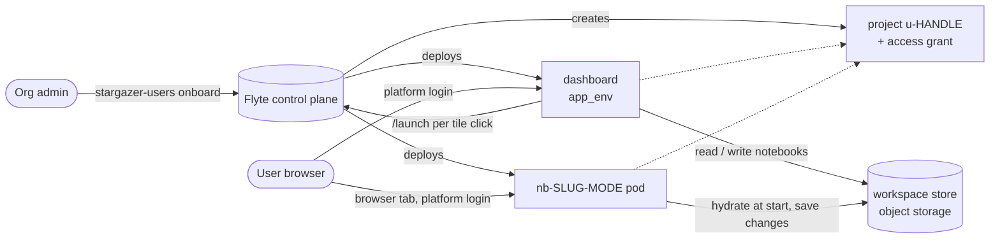
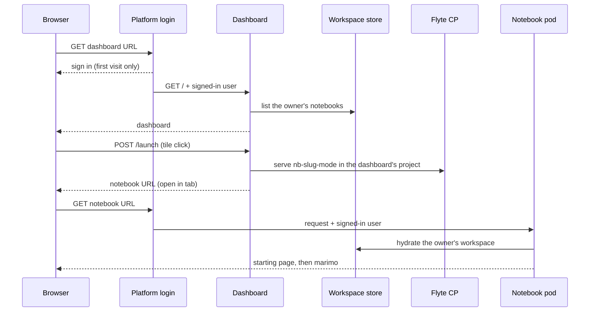
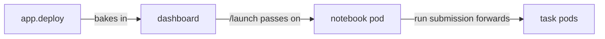

# App: Hosted Dashboard + Per-User Notebooks

The `app/` directory is **deployment glue**: FastAPI, Flyte AppEnvironment definitions, the workspace store. It lives outside `src/stargazer/` because it is not invokable by tasks or workflows; the SDK stays importable in environments without FastAPI or a Flyte control plane connection.

This doc is the high-level map of the hosting tier. For what the dashboard's notebook sections *mean* (taxonomy, archetypes, promotion paths), see [Notebooks](notebook.md). For implementation-level detail (identity headers, route table, pod launch, hydrate and sync mechanics), see the agent reference `.claude/reference/architecture/app_internals.md`.

Two kinds of Flyte `AppEnvironment` are defined here, and both sit behind the platform's login (`requires_auth=True`):

- **`app_env`** (the dashboard) — one per user, deployed into that user's own Flyte project. Renders their notebooks, keeps them in the workspace store, and launches notebook apps. It is keyed to its owner, and only its owner and the org's admins may open it.
- **Per-notebook envs** — built by the `per_notebook_env()` factory (`app/per_notebook.py`), one `nb-{slug}-{mode}` env per launch, deployed into the same project and owned by the same user.

A third piece runs outside the platform: **onboarding** (the `stargazer-users` command, kept in the infra repository beside the org's cloud infrastructure, which deploys dashboards through `app/deploy.py`), which an org admin runs from their own machine to give a user their project, access and dashboard.

## Topology

Each user has one project holding their dashboard and their notebook pods, and nothing else. Pods are spawned lazily when a tile's Edit/Run button is clicked. The dashboard never calls a pod: each pod loads and saves its owner's notebooks itself.

## Request Flow

## Core Concepts

**The platform owns sign-in.** There is no login page, OAuth flow or session cookie in the app tier. The platform gates every request to both app kinds and forwards the signed-in user's stable id (the *subject*), display claims and the signed token its login checked. Through an app's public address it overwrites any client-sent copy. But every app also answers at an in-cluster address that skips the login, where any pod can send whatever it likes, so on the hosted deploy the app tier trusts only the token: it checks the platform's signature on it and takes the subject from it. The subject keys everything per-user: the workspace store prefix, and the `_owner` stamped on assets.

**One project per user.** The platform admits a signed-in user to an app only if they can view the app's project, and anyone who can view a project sees every app in it. So each user gets their own project, `u-<handle>`, with access to that project and nothing else. Their dashboard and notebooks live there, and in the platform console they see only their own work. The project id is readable (from their email by default) and permanent.

**Runs are seen in the platform console.** The dashboard doesn't show runs itself. Its header links to the runs list of the dashboard's own project and domain in the platform console, where each run's graph, logs, inputs and outputs already are, so the owner lands on their own runs rather than the console's front page. The console is on the tenant's own address, which the platform gives every app pod. The devbox has no console, so its dashboard shows no link.

**The owner and the org's admins get in.** The platform admits whoever can view a project, but that check never runs on the in-cluster address, so the dashboard and its notebooks check for themselves: the token's subject must be the owner's, or one of the admins named when the dashboards are deployed. Anyone else signed in is turned away. A dashboard knows its owner from its deploy and keys its state by that owner, not by the visitor, so an admin sees the owner's notebooks. The asset index isn't behind the dashboard at all: the database admits only pods in the owner's project ([Asset Index](#asset-index)).

**Onboarding is an admin step, kept in the infra repository.** An org admin runs it to give a user their project, access, project key and dashboard; the CLI, its flags and its checks live there. This repo owns what it deploys through: `app.deploy.deploy_dashboard` serves the dashboard into the user's project at a stable, bookmarkable address, `login_for`, `iam_role_name` and `dsql_index_url` name the user's index, and `stargazer.config.PROJECT_KEY_SECRET` names the project key's secret. Nothing that runs on the platform needs the right to create projects or grant access, and no credential holding more than its user's own access is deployed anywhere. Releasing a new version redeploys every user's dashboard from the same images, each deployed under the commit it came from, so the platform console shows what every dashboard runs. A release also gives any project without a key its key, so it runs as an org admin, under their login or an API key.

**Pods act as their project.** Every pod on the platform, dashboards, notebooks and tasks alike, calls the platform with its project's own API key. Onboarding creates the key holding the user's access to that project and nothing else, and stores it as a secret in the project, which every environment declares. The platform gives pods no key of its own: without one, a workflow can't start its child tasks and a dashboard can't launch notebooks. So code in a user's notebook can start runs and apps in that user's project and nowhere else. The devbox has no login, so its pods declare no key.

**Notebook pods are gated by the platform too.** Each pod is baked with its owner's subject, which only keys where it loads and saves notebooks. Platform cookies and identity headers are stripped before a request reaches the notebook, so notebook code never sees a visitor's platform token through a request.

**Users are separated by Flyte project boundaries**, not by varying the env definition. Every per-notebook env is served into the user's project, so each user's runs, apps and cache stay in their own project, and their files sit under their own prefix in the store. The factory is parameterized by notebook (slug, mode, path, declared environment) and owner, so which project the env lands in is what separates users. **Storage isn't isolated per user:** every project runs as the same cloud role, so code in one user's notebook can read another user's objects. The dashboard carries an alpha notice asking users not to upload sensitive data.

**Saving just works.** A user's workspace lives in the workspace store: object storage, one object per file at its path, under the user's subject. Notebooks are files like any other, and so is whatever the user keeps beside them: data, helper modules, outputs. There's no opt-in and no setup. The store is the durable copy and pods are working copies. A pod loads its owner's whole workspace when it starts and writes changed files back every 30 seconds, unless the user picks another interval in the Settings modal the dashboard's header opens, and at 0 only when the pod stops. The interval is read when a notebook starts, so a change applies to notebooks started afterwards. The settings are stored beside the user's workspace, not in it. A file deleted in the pod is deleted from the store. The pod does a final save when it scales to zero. A pod that dies without warning loses what changed since its last save. Each pod writes only the files it changed, so two running notebooks overwrite each other's work only when both change the same file. Dotfiles and Python's and marimo's caches aren't saved.

**Big files belong in the asset store.** A file over 100 MB isn't saved with the workspace. It stays on the pod's disk until the pod stops, and the notebook page names it, with a cell that stores it as an asset straight from the pod, which has no size limit. The limit keeps the final save small enough to finish before the pod is killed.

**Notebooks come in from GitHub by link.** A notebook file in a public GitHub repository opens in the workspace from a link to it, either its page or its raw file. The dashboard downloads it from GitHub's raw file host, and no other, up to 1 MB, and adds it the way it copies a workflow: named by the notebook's declared name, else its file name, and never over an existing notebook. A link pinned to a commit gets the same file every time. Only the one file comes in, not the files beside it.

**Sharing upstream is a download.** Any workspace notebook can be downloaded as its `.py` file and contributed to the repository like any other change. The app tier never writes to GitHub.

**The notebook declares its pod.** A workspace notebook declares the environment its pod runs in as `main_env` in its setup block, a `flyte.app.AppEnvironment` cloned from `notebook_env` ([Notebooks → Notebook Environment](notebook.md#notebook-environment)), beside its tile's `main_name` and `main_description`, which the dashboard reads without running code. At launch the dashboard evaluates just the `main_env` expression and serves a clone of it with its own fields on top: the app's name, launch command, port, login, scaling, URL and secrets, and the env vars that belong to whoever launches the notebook (owner, store root, index), which win over the notebook's. The notebook's image, resources and other env vars are the pod's. Resources are honored as-authored, with no ceiling; any a notebook leaves out, including the disk its kernel's environment and files live on, come from `notebook_env`'s defaults, and tutorials and workflows run in `notebook_env`. A declared image is built on Union's remote builder in the user's own project, unless it's already built. An image that's built is served at once; one that isn't answers the launch straight away, the tile shows the build, and the dashboard serves the notebook when the build finishes, so a long build never outlasts the request. The expression is the one piece of notebook code the dashboard runs: the owner's, in the owner's own dashboard. The dashboard's secrets are the org's Pinata key and the project's own key, which any of the owner's tasks can read anyway. The gear on a workspace tile opens the setup block in an editor; saving checks that the dashboard can read the name and description and serve the environment before writing it back. The gear won't save while the notebook is running, since its pod would save its own copy over the edit; the setup block is then edited in the notebook itself.

**Tiles are stateful and authoritative.** On load the dashboard asks the control plane which `nb-{slug}-{mode}` apps are live and hydrates those tiles to Open/Stop; a notebook runs in edit *or* run mode, never both. Discovery is a single project-scoped deployment list, re-checked per app for authoritative status. This is read from Flyte rather than in-memory state, so it survives dashboard restarts.

**The tier is lightweight by construction.** Dashboard responses are gzip-compressed, and the notebook proxy streams everything except the HTML pages it decorates, so large notebook assets never sit in proxy memory. Details in `.claude/reference/architecture/app_internals.md`.

## Asset Index

Each user's **asset index**, the metadata behind `assemble()` for every file their tasks and notebooks store, is their own table on the org's Aurora DSQL cluster. The dashboard's asset browser, the user's notebook pods and the task pods their runs start all reach it directly, at the address the dashboard is deployed with, so no index call goes through the dashboard: it can scale to zero or be redeployed while runs are writing. The files themselves go straight to the bucket, under the same root as the user's notebooks.

**The database keeps each user to their table.** Every user has a login on the cluster that holds rights on their table and nothing else, and logging in takes a token signed by their own cloud role. Only pods in the user's project can assume that role, with the service-account token the cluster gives them, so a pod in another project is refused before it reaches the database, and nothing a user can run changes their own table's shape. Onboarding makes the role, the table, the login and the grants; offboarding deletes the role and keeps the table, as it keeps the notebooks. DSQL refuses a write that conflicts with a concurrent one instead of making it wait, so a refused write is retried; reads are strongly consistent, so a task always sees its upstream task's rows.

The devbox keeps its index on a Postgres server, which the dashboard and every pod reach the same way. DSQL accepts a subset of what Postgres does, so a failure only DSQL raises shows up only on the tenant.

See [Configuration](configuration.md) for the storage model and `.claude/reference/architecture/app_internals.md` for the mechanics.

## Asset Manager

The dashboard's home page holds the asset browser, below the notebook
sections: a browse-and-upload surface with two tabs. Routes live in
`app/assets.py`; mechanics and the route table are in
`.claude/reference/architecture/app_internals.md`.

**Private is the user's own index and store**, the same ones their tasks
and notebooks write to, so the tab shows everything they've stored. Only the
dashboard's owner reaches them. It works on every dashboard, with or without
a Pinata key.

**Private uploads are resumable, up to 10 GB.** The browser sends the file in
pieces over the TUS protocol, and the dashboard passes each piece straight on
to the store as one part of a multipart upload, working out the CID as the
bytes go by, so the file never lands on the dashboard's disk. The last piece
writes the index row. The file stays where it was uploaded, under the user's
`uploads/`, and the row points there; the same file uploaded again is
deleted and the first row kept. An upload in progress lives in the
dashboard's memory: a dropped connection or a reloaded page resumes from what
arrived, while a dashboard restart starts it over, and an upload left idle
for an hour is dropped. Downloads stream back out through the dashboard.

**Public is Pinata's public network**, called directly with the org's Pinata
key, which the dashboard holds as a Flyte secret that its owner can't read
from the app's spec (see [Configuration → The public tier](configuration.md#the-public-tier)).
Pinata's private network is never used: the key is shared across the org, so
it would keep nothing private. The devbox drops app secrets, so a devbox
dashboard has no public tier. A deploy can also turn public assets off for its
dashboards: the Public tab says shared data isn't available, and the upload
form offers only private storage. That's the dashboard alone; the user's tasks
and notebooks still read the public tier.

**Public uploads are resumable, up to 10 GB, through the dashboard.** The
browser sends the file in pieces over TUS to the same endpoint as a private
upload, and the dashboard passes each piece on to a TUS upload of Pinata's,
working out the CID as they go by. A CID from Pinata that differs from the
dashboard's means the file didn't arrive intact, so it's deleted from Pinata
and the upload fails. Only the user who started an upload can continue it.
Validation is the *same* `build_asset()` choke point the MCP server uses, so
the page and the SDK agree on what a valid upload is, and it runs before any
of the file is sent, for both networks. **A registered type's form takes extra
fields** below its declared ones, stored as text on the typed asset (see
[Types → Extra keys](types.md#extra-keys)). Public downloads redirect to
Pinata's gateway: those bytes go browser↔Pinata, not through the pod. The
numbers and status codes are in `app_internals.md`; Pinata's limits are in
[Configuration](configuration.md#pinata-upload-paths).

**Ownership is attribution, not enforcement.** Every hosted write stamps the
user's subject as `_owner`, and the page's edit route checks it server-side;
[Types → Ownership](types.md#ownership-_owner) owns the rest.

**Reading public data needs no ownership.** Public-network bytes are
world-readable on IPFS, and the public routes answer an anonymous request (a
local run). The listing is served from a short in-process TTL cache, and every
download, anonymous or not, redirects to `PINATA_GATEWAY`, the account's
dedicated gateway, which meters bandwidth. Free public gateways rate-limit
full downloads.

**The browser sits on the dashboard's home page**, below the notebook
sections, and leaves out notebooks, which have their own sections there
([Public Notebooks](#public-notebooks)). It offers two interchangeable renderings of
the same listing, switched by a Graph/List toggle (Graph is the default):

- **Graph** draws assets as nodes and their links (`companion_of` and the
  `*_cid` provenance links) as edges. Hovering a node peeks its metadata;
  clicking pins a detail card with the full metadata, its linked assets and a
  download button, and on a record the signed-in user owns, **Edit metadata**,
  an in-place fix for a mis-tagged record. Zoom, pan and drag are
  interactive; the mechanics are in `app_internals.md`.
- **List** is the same records as a sortable table (CID, name, owner, type,
  metadata, download). The upload panel below is schema-driven: pick a
  registered type or a bare/custom asset, fill metadata, choose Private or
  Public. The upload appears in the listing straight away.

## Public Notebooks

**A workspace notebook is a file until it's published.** Its tile's Publish
button uploads it to Pinata's public network as a `Notebook` asset, through
the same Pinata client and TUS upload the asset browser uses, stamped with
the notebook's owner as `_owner`. Its `title` and `description` are the
setup block's `main_name` and `main_description`, and its `slug` is the
workspace filename's stem, which ties the public record to the notebook. A
description past Pinata's value limit is refused before anything is sent.

**One public record per notebook.** Publishing again uploads the current
file and then deletes the owner's earlier records with the same `slug`, and
Unpublish deletes them all. Both look records up by the owner's `_owner`, so
another user's notebook with the same slug is never touched. Pinata stores
identical bytes once per account and keeps the first upload's keyvalues, so
a file that's already public under another record can't be published again:
the dashboard refuses it and deletes nothing.

**The dashboard lists every public notebook** in a Public notebooks section
beside the user's own, from the asset browser's cached public listing.
Copying one into the workspace reads its bytes from the gateway and writes a
fresh workspace notebook, saved like any other file; a later Republish by its
author doesn't change the copy. The notebooks shipped in the repository
aren't published: GitHub already makes them public.

**The public switch covers it.** A dashboard without public assets (no key,
or turned off for the deploy) shows no Publish, Unpublish or Public notebooks
section, and their routes answer 503.

## Contract with the SDK

`app/` imports the SDK's public API, and the SDK never imports `app/` (the import layers enforce it). **At runtime the two also meet in three places their imports don't show**: the asset keyvalues, the asset index and the environment a deploy hands down. These are the API between the tiers, so a change to one on either side lands on the other in the same change.

**Asset keyvalues.** Every stored record, an index row or a public file, carries a flat map of strings. `asset` names the type by its registry key. Each field the type declares, as `Asset.declared_fields()` lists them, holds its value as written if it's a string and as JSON otherwise. Any other key is an extra, kept as text. Keys starting with `_` are reserved for stamping, and `_owner` is the one in use. The asset browser builds its upload form from the registry and each type's declared fields, and validates uploads and edits with the SDK's `build_asset()`, so the page accepts exactly what the SDK does. The rules are in [Types → Serialization](types.md#serialization), [Extra keys](types.md#extra-keys) and [Ownership](types.md#ownership-_owner).

**The asset index has no server.** Nothing in either tier serves the index over HTTP: the dashboard, its notebook pods and the task pods they start each open it directly from `STARGAZER_INDEX_URL`, through the SDK's `stargazer.utils.index`. The contract is that URL and the table it names.

| `STARGAZER_INDEX_URL` | Index | Used |
|---|---|---|
| A file path | A SQLite file | Locally |
| `postgresql://…` | A Postgres table | The devbox |
| `dsql://<login>@<cluster endpoint>/assets.<login>?role_arn=<IAM role>` | The user's table on Aurora DSQL, opened as their own login | Union |

The deploy writes the DSQL URL from the project's names alone (`app.deploy.dsql_index_url`), and onboarding creates the login, the IAM role and the table under those same names, the table from the SDK's own definition. The table has one row per CID: where the bytes live, the original filename, the keyvalues as JSON, and when the row was written.

**The environment flows down from the deploy.** The deploy bakes four variables into each dashboard, the dashboard hands them to every notebook pod it launches, and the SDK forwards three of them into the task pods a run starts. The SDK reads them; the app tier only sets and passes them on.

| Variable | Set by the app tier | Read by the SDK | Reaches task pods |
|---|---|---|---|
| `STARGAZER_INDEX_URL` | The user's index: their DSQL table, or the devbox's Postgres | The storage client and `make_index()` open the index from it | Yes |
| `STARGAZER_STORE_ROOT` | The workspace root, so assets sit beside the user's notebooks; unset when the deploy names no root | The storage client stores bytes at `<root>/users/<owner>/assets/<cid>/<name>` | Yes, when set |
| `STARGAZER_OWNER` | The owner's platform subject | The storage client's folder in the store, and the `_owner` stamped on every index row and public upload | Yes, when set |
| `STARGAZER_NOTEBOOK_IMAGE` | The notebook image's content-hashed URI, built once per deploy | `stargazer.notebooks.notebook_base` builds on it, so a notebook's declared image layers on the one its pod runs | No |

Defaults and the rest of the SDK's settings are in [Configuration → Environment Variables](configuration.md#environment-variables).

## Images

The dashboard and the per-notebook pods use **different images by design**:

- `app_env.image` is Flyte-built via `with_uv_project` — the dashboard is small Python with no heavy deps.
- Per-notebook envs use the programmatically-defined `notebook-app` image. The deploy builds it and hands each dashboard the exact build, so every notebook pod runs the image that shipped with its dashboard and the dashboard pod (no Docker daemon) never rebuilds it. A notebook that declares its own image runs on a build layered on that one, which `serve` builds on Union's remote builder; that needs only the Flyte API, no Docker.

Both images are content-hashed, so a release builds each once however many users it deploys, and every user's dashboard runs the same build.

## Deploy Targets

One switch, `STARGAZER_TARGET`, picks the backend: `devbox` (the default, a local cluster for lightweight testing) or `union` (the hosted tenant). The app tier is built around the platform's login, which the devbox doesn't have, so the devbox gets one dashboard for a stand-in user instead of per-user onboarding, and a Postgres server for the asset index: enough to test asset storage and the dashboard locally. The stand-in is never honored on Union. Setup and rationale are in `devbox/`, its `setup.sh` and `dashboard.py`. It selects the deployer's Flyte config and where images are pushed. The Flyte domain is set separately, so the same target can serve a development or a production deployment. The per-target table is in `.claude/reference/architecture/app_internals.md`.

The project `Dockerfile`'s `stargazer` is the hosted notebook image's recipe as a local `docker run`, defined separately in the `Dockerfile`; it is not the hosted build. Build/publish detail in `.claude/reference/architecture/app_internals.md`.
