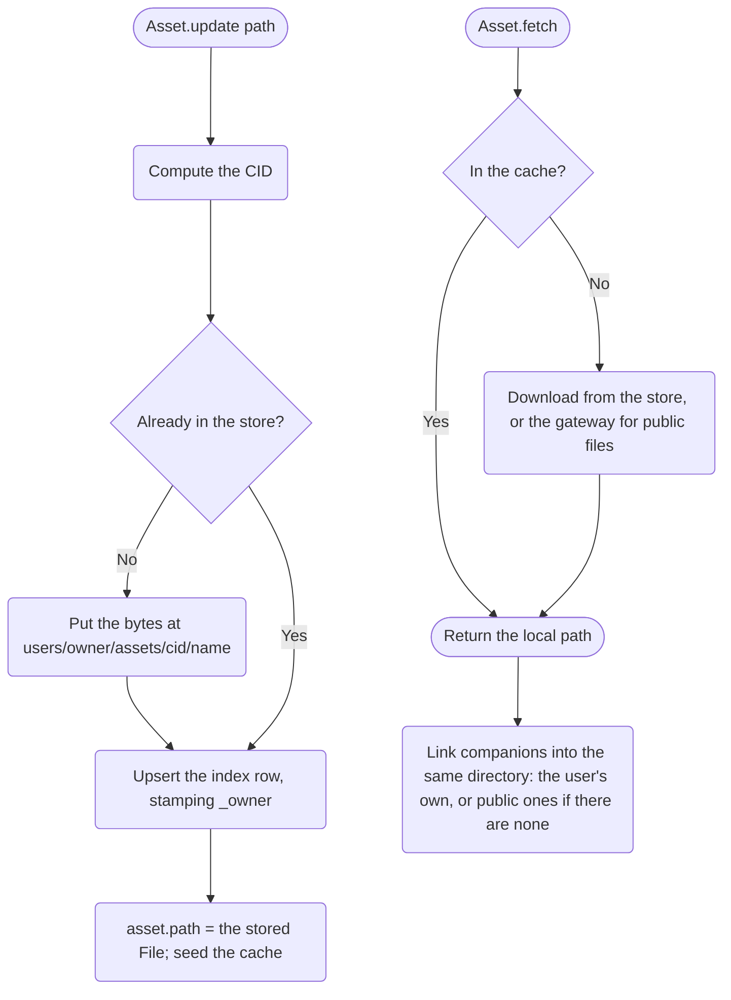

# Configuration

Asset storage has three parts: an **object store** for the bytes, an **index** for the metadata, and a **local cache** in front of both. A fourth, the **public tier**, holds shared data on Pinata's public network. The same code runs locally and on a hosted deploy; only the locations differ.

| Part | Locally | On Union | Set by |
|------|---------|----------|--------|
| Object store | `~/.stargazer/store` | The tenant bucket, under the deploy's root | `STARGAZER_STORE_ROOT` |
| Index | `~/.stargazer/index.db` (SQLite) | The user's own table on Aurora DSQL | `STARGAZER_INDEX_URL` |
| Local cache | `~/.stargazer/local` | The pod's disk | `STARGAZER_LOCAL` |
| Public tier | Off without a key | Pinata's public network | `PINATA_JWT` |

On Union the dashboard and every pod in the user's project reach their table directly, logged in as the user ([App → Asset Index](app.md#asset-index)). On the devbox, the local cluster for development, the index is a Postgres server that every pod and the dashboard reach the same way ([Contributing → Running on the Devbox](../guides/contributing.md#running-on-the-devbox)).

## Identity and layout

An asset's identity is its **IPFS CID**, computed locally from the bytes with the same parameters Pinata uses, so a file's working CID is the CID it keeps if it's ever published. Each user's files are stored once, at `<store root>/users/<owner>/assets/<cid>/<name>`, where the owner is `STARGAZER_OWNER` (the Union subject) or `local`. An asset's `path` is a `flyte.io.File` naming that stored location, so an asset passed between tasks points somewhere every pod can read.

The index holds one row per CID: where the bytes live, the original filename, and the asset's keyvalues. Re-recording a CID with different keyvalues replaces them and logs a warning. Rows are written after the bytes, so a row never points at a missing file, and a write that doesn't land fails the task rather than being retried behind its back.

The cache keeps each downloaded file at `<STARGAZER_LOCAL>/<cid>/<name>`. Uploads seed it, so a task's outputs are already cached in the same pod or local run.

## Environment Variables

All env var defaults are set in `config.py`. If set (even to empty string), the value is used exactly. If unset, the default applies.

| Variable | Purpose | Default | Required |
|----------|---------|---------|----------|
| `STARGAZER_STORE_ROOT` | Object-store root: a directory or a bucket URI | `~/.stargazer/store` | No |
| `STARGAZER_INDEX_URL` | Index: a SQLite file path, a `postgresql://` URL, or a `dsql://` URL naming a user's table and login on Aurora DSQL | `~/.stargazer/index.db` | No |
| `STARGAZER_LOCAL` | Scratch space for task outputs, and the download cache | `~/.stargazer/local` | No |
| `STARGAZER_OWNER` | Owner of new assets: their folder in the store, and `_owner` | None (unset → `local`) | No |
| `PINATA_JWT` | Turns on the public tier | None (unset) | Only for public data |
| `PINATA_GATEWAY` | IPFS gateway for public downloads | `https://maroon-written-fowl-769.mypinata.cloud`, the project's dedicated Pinata gateway | No |
| `STARGAZER_TARGET` | Flyte backend for images and deploys: `devbox` or `union` | `devbox` | No |
| `STARGAZER_REGISTRY` | Image push registry | `localhost:30000` on `devbox`; unset on `union` (the builder's own registry) | No |
| `FLYTE_DOCKER_BUILD_EXTRA_ARGS` | Extra flags for local image builds | `--provenance=false` on `devbox` | No |

`STARGAZER_STORE_ROOT` and `STARGAZER_INDEX_URL` are forwarded into task pods only when set explicitly. A pod can't use the local default store or index, so a remote run submitted locally with the defaults has nowhere shared to write.

On Union, `PINATA_JWT` is a Flyte secret ([The public tier](#the-public-tier)).

## Connecting to Flyte

Notebooks, the MCP server and the tests connect with `init_flyte()` from `config.py`. Locally it reads `.flyte/config.yaml`, and with no config file runs stay in the caller's own process. A hosted notebook pod has no config file, so there it connects to the owner's project on the cluster the pod runs on, with the project's own API key. On Union every task environment, dashboard and notebook pod declares that key as a secret (`PROJECT_KEY_SECRET`), as it does the Pinata key, since the platform gives pods none of its own ([App Tier → Core Concepts](app.md#core-concepts)). The app tier has its own init (`app.init`), which also accepts an API key, since the SDK never imports the app tier.

## Writing and reading

`fetch()` returns the local path. Companions — assets whose `companion_of` is this asset's CID, such as an index or dictionary — land in the same directory, where tools like GATK look for them. They come from three places, in order: the user's own index, public companions the user published (their `_owner` is `STARGAZER_OWNER`), so one that's no longer in the store is fetched again, and public companions from whoever published the asset itself. A private copy of a public reference shares its CID, so it gets the publisher's index and dictionary. Anyone else's public companions are left out, so a popular reference never collects builds from several publishers, and a file nobody published has no publisher to follow. A name already taken isn't taken again: a user's own `ref.fa.bwt` stands, and the publisher's fills in only the names the user lacks. An asset built from a local file that was never stored is used in place. An asset known only by its CID is located through the index, then the public gateway.

Gateway downloads use aiohttp directly: `flyte.io.File.download()` can't read an `https://` path.

## Querying

`assemble(**filters)` asks the storage client for every record matching all the filters. Every key must match exactly; a list value matches any of its entries, in one query. With a Pinata key, Pinata's public records join the user's rows, deduplicated by CID, with the user's own row winning. `fetch()`'s companion lookup is the exception: it uses the user's companions or the public ones, never both (see [Writing and reading](#writing-and-reading)).

## The public tier

Shared data — bundles, reference genomes — is public data on Pinata's public network: anyone can read it, and `_owner` records who uploaded it. Every public record needs an `_owner`: a public upload or edit without one is refused before anything is sent (so publishing needs `STARGAZER_OWNER`), and a public file without one, uploaded straight to Pinata, is left out of every read. The SDK reads Pinata's public index (which needs `PINATA_JWT` even for public files) and downloads public bytes from `PINATA_GATEWAY`. Nothing uses Pinata's private network: the asset browser's Private tab is the user's own index and store, and its Public tab calls Pinata's public network directly. On Union the key is a Flyte secret that every task environment, dashboard and notebook pod declares, so it is set wherever Stargazer runs and its value never appears in a task's or an app's spec. The devbox drops app secrets, so devbox dashboards and notebook pods have no public tier.

**Publishing moves a stored asset into the public tier.** `StorageClient.publish(cid)` uploads one of the user's stored files to Pinata with its index row's keyvalues, `_owner` restamped. The CID has to come back the same: ours is computed with Pinata's parameters, so a different one raises instead of passing quietly. The user's row stays, so the asset is in both tiers, and queries keep the row over the public duplicate. Companions aren't published with their asset. The MCP server exposes it as `publish_file`.

### Pinata upload paths

`PinataClient.upload()` size-branches. Files up to 100MB use the plain
multipart POST (one round trip, CID in the response body). Larger files use
Pinata's resumable **TUS** endpoint — chunked `PATCH`es, CID read from the
`Upload-Cid` header on the completing request. The split is required, not an
optimization: Pinata's plain POST is hard-capped at 100MB. The TUS path is
chunked, not resumable across calls, with a 10 GiB/file ceiling — itself a Pinata
limit, not an IPFS one (IPFS chunks files into a DAG with no inherent size
cap).

**A new Pinata file holds at most 9 keyvalues, `_owner` included.** Pinata
refuses more, so `upload()` and `tus_create()` check the count first and
raise before anything is sent: a plain POST would ship the whole file to get
a 400. Metadata updates aren't
capped by Pinata and aren't checked. The limit bounds how many
[extra keys](types.md#extra-keys) a typed asset can carry on the public tier;
the user's own index has no such cap.

**Each Pinata key and value is at most 250 characters.** A new file refuses
251; an update allows 255 and answers 256 with a 400 that doesn't say why.
`upload()`, `tus_create()` and `update_metadata()` hold every
key and value to 250 and raise before anything is sent, so whatever can be
edited onto a record could also be uploaded with it. A list stored as one
value reaches it first: a cohort's `source_samples` passes 250 characters at
about 20 sample IDs. The user's own index has no such limit.

Every `PinataClient` call is on the public network (`NETWORK`). `query(keyvalues)`
returns its matching records.

`tus_create(filename, keyvalues, length)` and `tus_patch(location, offset,
chunk)` are the TUS path's two steps on their own, for a caller that has the
file one chunk at a time: the dashboard's asset browser passes on a public
upload's pieces as the browser sends them, and `tus_patch` returns the CID
once the last one lands — see [App → Asset Manager](app.md#asset-manager).

## Container Images

Stargazer has five container images. They split along a sharp line: **Flyte-built images** (run only by Flyte) are declared as `flyte.Image`s, the task images on the `TaskEnvironment`s in `src/stargazer/config.py` and the two hosted-app images in `app/`; the **human-runnable image** (used via `docker run`) is built from the project's multi-stage `Dockerfile`.

| Image | Source | Type | Where it runs |
|-------|--------|------|---------------|
| `stargazer-scrna` | `config.py` (`scrna_env`) | `flyte.TaskEnvironment` | scRNA-seq tasks (`tasks/scrna/`) |
| `stargazer-gatk` | `config.py` (`gatk_env`) | `flyte.TaskEnvironment` | GATK + alignment tasks (`tasks/gatk/`, `tasks/general/`) |
| `notebook-app` | `app/per_notebook.py` (`notebook_app_img_recipe`) | `flyte.Image` | Hosted notebook pods |
| the dashboard image | `app/admin_app.py` (`app_env`) | `flyte.Image` via `with_uv_project` | Each user's dashboard |
| `stargazer` | `Dockerfile` | Marimo behind the terminal proxy, Claude Code, the bioconda tools | Local `docker run` only |

Why the split: Flyte-built images need nothing but Flyte's contract (an entrypoint Flyte injects, a content-hash tag Flyte pins by) — perfectly served by the SDK. A human-runnable image needs a real `ENTRYPOINT`, baked-in source, and a stable `:latest` tag — none of which the Flyte Image SDK exposes. Rather than reinvent the Dockerfile via post-build wrapping, we just use a Dockerfile.

Both task images install the stargazer package itself, not only its dependencies. A task pod finds the tasks a workflow calls by their installed module names, so without the package a workflow's child tasks can't load, wherever the run was submitted from. Your own tasks and workflows still travel in each run's code bundle. Since the package is in the image, a change to the project's source builds new task images; `.dockerignore` keeps docs, tests and local caches out of the build context, so they don't.

**An installed package runs published task images.** A task's code runs from its image, so the image has to carry the same `stargazer` as the caller. In a source checkout (the package's root has a `pyproject.toml`, an editable install included) the task images build from their recipes as above. An installed package has no project to build from, so `gatk_env` and `scrna_env` run `ghcr.io/stargazerbio/stargazer-gatk:<version>` and `stargazer-scrna:<version>` for the installed version instead, with nothing to build. CI builds those from the same recipes when a version is tagged ([Contributing → Building Images](../guides/contributing.md#building-images)).

Every image Flyte builds — the task images, the dashboard, the notebook image — is built for `linux/amd64` only, the architecture Union runs. GATK's GenomicsDB, which joint calling uses, has no arm64 build. On an Apple-silicon devbox the cluster itself runs natively and these pods run under emulation. A devbox build pushes a plain image rather than a multi-platform index (`FLYTE_DOCKER_BUILD_EXTRA_ARGS` defaults to `--provenance=false` there), since an arm64 node won't pull an index with no arm64 entry.

The `Dockerfile` image is published for both `linux/amd64` and `linux/arm64`, so it runs natively on Apple silicon. It carries the bioconda tools and a Flyte config that runs workflows in the container; a notebook's own dependencies come from its PEP 723 header, as in a hosted pod. Because GenomicsDB has no arm64 build, joint calling works only in the amd64 variant.

Hosted notebook pods run **`notebook-app`**, defined programmatically in `app/per_notebook.py` and built by the deploy (`app.deploy.build_notebook_image`). `stargazer` mirrors that recipe in the `Dockerfile` without sharing code with it (a unit test keeps its pip packages in step; tool versions can lag), because a published, multi-arch image needs a real `ENTRYPOINT` and a stable tag the Flyte Image SDK doesn't expose. See [App → Images](app.md#images).

### Building locally

The Flyte task images build the first time a run needs them, tagged by content hash, with the builder selected in the Flyte config: `local` needs a working Docker daemon, `remote` (Union only) builds on the cluster. They are pushed to `STARGAZER_REGISTRY`, which on `devbox` defaults to the devbox's own registry (`localhost:30000`) and on `union` is left to the remote builder, which pushes to Union's registry. The human-runnable image builds from the Dockerfile and is tagged with its published `ghcr.io/stargazerbio` URL even when local-only, so docker resolves it from the local cache by name. CI publishes it when a merge changes the image's own files, and on demand. Commands in [Contributing → Building Images](../guides/contributing.md#building-images).

### Adding a tool

When a new Flyte task wraps a new CLI tool, layer it onto the image of the `TaskEnvironment` it is decorated against in `config.py` — via `with_apt_packages`, `with_commands`, or the bioconda install block. A tool notebooks should reach directly goes in the bioconda block of the hosted notebook image (`notebook_app_img_recipe` in `app/per_notebook.py`), and in the Dockerfile's matching bioconda line. See [Writing a Task](../guides/writing-a-task.md).

## Resource Bundles

Bundles are curated sets of public files (reference genomes, demo datasets) defined as YAML manifests in `src/stargazer/bundles/`. Each manifest lists its files' CIDs and keyvalues; a manifest can tag its files with a `bundle` keyvalue so they can be queried as a set (`scrna_demo` does).

### Fetching

`fetch_resource_bundle(bundle_name)` downloads each file by CID from the IPFS gateway into the local cache and registers it in the user's index, pointing at the gateway. A fetched bundle is then findable with `assemble()` whether or not a Pinata key is set; with one, the same files also come back through the public tier.

### Bundle Format

A manifest carries a `name`, a `description`, and a `files` list; each file entry is a `cid`, the file's `name` (the filename tools see on disk), and its `keyvalues` (asset type and metadata). See the manifests in `src/stargazer/bundles/` for live examples.

After hydration, bundled assets are queryable via `assemble()` and `query_files` like any other asset.

