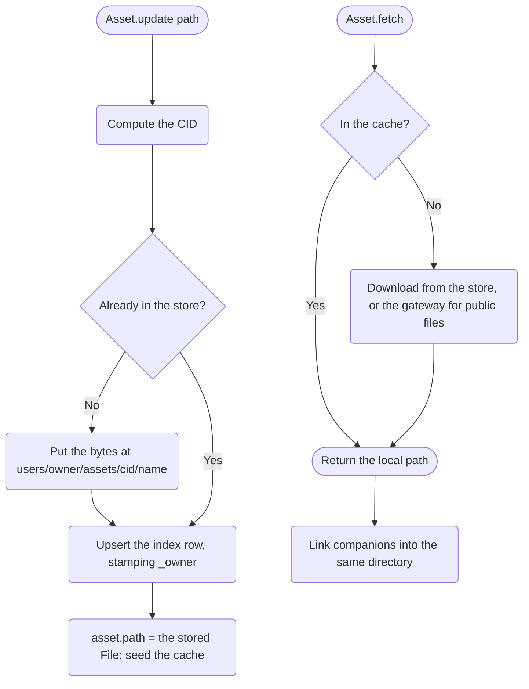

# Configuration

Asset storage has three parts: an **object store** for the bytes, an **index** for the metadata, and a **local cache** in front of both. A fourth, the **public tier**, holds shared data on Pinata's public network. The same code runs locally and on a hosted deploy; only the locations differ.

| Part | Locally | On Union | Set by |
|------|---------|----------|--------|
| Object store | `~/.stargazer/store` | The user's own prefix in the user bucket | `STARGAZER_STORE_ROOT` |
| Index | `~/.stargazer/index.db` (SQLite) | The user's own table on Aurora DSQL | `STARGAZER_INDEX_URL` |
| Local cache | `~/.stargazer/local` | The pod's disk | `STARGAZER_LOCAL` |
| Public tier | Off without a key | Pinata's public network | `PINATA_JWT` |

**On Union every pod in the user's project runs as the user's own cloud role**: the dashboard, their notebook pods and the task pods their runs start. That role reaches their prefix of the store, their index table and nothing of anyone else's, and the pods reach both directly, with no service in between. On the devbox, the local development cluster, the index is a Postgres server that every pod reaches the same way ([Contributing → Running on the Devbox](../guides/contributing.md#running-on-the-devbox)).

## Identity and layout

An asset's identity is its **IPFS CID**, computed locally from the bytes with the same parameters Pinata uses, so a file's working CID is the CID it keeps if it's ever published. Each user's files are stored once, at `<store root>/users/<owner>/assets/<cid>/<name>`, where the owner is `STARGAZER_OWNER` (the Union subject) or `local`. An asset's `path` is a `flyte.io.File` naming that stored location, so an asset passed between tasks points somewhere every pod can read.

The index holds one row per CID: where the bytes live, the original filename, and the asset's keyvalues. Rows are written after the bytes, so a row never points at a missing file. The cache keeps each downloaded file at `<STARGAZER_LOCAL>/<cid>/<name>`; uploads seed it.

## Environment Variables

All defaults are set in `config.py`. If a variable is set (even to an empty string), the value is used exactly; if unset, the default applies.

| Variable | Purpose | Default |
|----------|---------|---------|
| `STARGAZER_STORE_ROOT` | Object-store root: a directory or a bucket URI | `~/.stargazer/store` |
| `STARGAZER_INDEX_URL` | Index: a SQLite file path, a `postgresql://` URL, or a `dsql://` URL | `~/.stargazer/index.db` |
| `STARGAZER_LOCAL` | Scratch space for task outputs, and the download cache | `~/.stargazer/local` |
| `STARGAZER_OWNER` | Owner of new assets: their folder in the store, and `_owner` | unset → `local` |
| `PINATA_JWT` | Turns on the public tier | unset |
| `PINATA_GATEWAY` | IPFS gateway for public downloads | The project's dedicated gateway |
| `STARGAZER_API_KEY_SECRET` | The Flyte secret holding the project's API key (needed on a cluster with a login, such as Union) | unset |

`STARGAZER_STORE_ROOT` and `STARGAZER_INDEX_URL` are forwarded into task pods only when set explicitly. A pod can't use the local default store or index, so a remote run submitted locally with the defaults has nowhere shared to write.

Where images are pushed is Flyte's own setting, `FLYTE_IMAGE_REGISTRY`; Stargazer sets none. Set it in the environment of whatever targets a cluster that needs one (the devbox's is `localhost:30000`), never in a config file a Union run might also find.

## Connecting to Flyte

Notebooks, the MCP server and the tests connect with `init_flyte()` from `config.py`. Locally it reads `.flyte/config.yaml`, and with no config file runs stay in the caller's own process. A hosted notebook pod has no config file, so it connects to the owner's project on its own cluster, with the project's API key. Every task environment declares that key's secret, so the tasks a pod starts can start their own children. A cluster without a login, such as the devbox, has no key and declares none.

## Writing and reading

`fetch()` returns the local path. Companions — assets whose `companion_of` is this asset's CID, such as an index or dictionary — land in the same directory, where tools like GATK look for them. They come from the user's own files first, then from public ones the user or the asset's original publisher uploaded; nobody else's are taken, so a popular reference never collects builds from several publishers. An asset known only by its CID is located through the index, then the public gateway.

`assemble(**filters)` asks the storage client for every record matching all the filters. Every key must match exactly; a list value matches any of its entries. With a Pinata key, public records join the user's rows, deduplicated by CID, with the user's own winning.

## The public tier

Shared data — bundles, reference genomes — lives on Pinata's public network: anyone can read it, and `_owner` records who uploaded it. Every public record needs an `_owner`, so publishing needs `STARGAZER_OWNER`. The SDK reads Pinata's public index (which needs `PINATA_JWT` even for public files) and downloads public bytes from `PINATA_GATEWAY`. On Union the key is a Flyte secret every task environment, dashboard and notebook pod declares, so its value never appears in a task's or app's spec. The devbox drops app secrets, so devbox dashboards and notebook pods have no public tier.

**Publishing moves a stored asset into the public tier.** `StorageClient.publish(cid)` uploads one of the user's stored files to Pinata with its keyvalues, `_owner` restamped. The CID must come back the same, or it raises. The user's own row stays, so the asset is in both tiers. Companions aren't published with their asset. The MCP server exposes it as `publish_file`.

A new public file holds at most 9 keyvalues (`_owner` included), each at most 250 characters. The user's own index has no such limits.

## Container Images

| Image | Source | Where it runs |
|-------|--------|---------------|
| `stargazer-scrna` | `config.py` (`scrna_env`) | scRNA-seq tasks (`tasks/scrna/`) |
| `stargazer-gatk` | `config.py` (`gatk_env`) | GATK + alignment tasks (`tasks/gatk/`, `tasks/general/`) |
| `stargazer` | `runtime/Dockerfile` | Every notebook: `docker run` locally, and hosted notebook pods ([Notebook Runtime](runtime.md)) |

The task images are declared as `flyte.Image`s on the `TaskEnvironment`s in `config.py` and built by Flyte the first time a run needs them, tagged by content hash. Both install the stargazer package itself, so a workflow's child tasks load by their installed module names wherever the run was submitted from; your own tasks and workflows still travel in each run's code bundle. The task images are `linux/amd64` only, the architecture Union runs. The `stargazer` image is published for `amd64` and `arm64`; joint calling works only in the `amd64` variant. Build commands are in [Contributing → Building Images](../guides/contributing.md#building-images).

To add a tool a task wraps, layer it onto the image of the `TaskEnvironment` the task uses in `config.py`. A tool notebooks should reach directly goes in the bioconda line of `runtime/Dockerfile`. See [Writing a Task](../guides/writing-a-task.md).

## Resource Bundles

Bundles are curated sets of public files (reference genomes, demo datasets) defined as YAML manifests in `src/stargazer/bundles/`. A manifest carries a `name`, a `description`, and a `files` list of each file's `cid`, `name` and `keyvalues`. `fetch_resource_bundle(bundle_name)` downloads each file by CID from the IPFS gateway and registers it in the user's index, so it is findable with `assemble()` whether or not a Pinata key is set.

For the mechanics behind all of this, see the agent wiki's `.claude/wiki/storage.md`, `provenance.md` and `images.md`.
