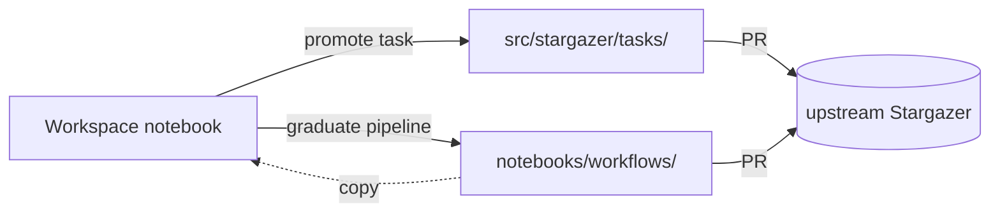

# Notebooks

The marimo notebook is Stargazer's primary user surface. Researchers think in analyses — load data, run a pipeline, look at a plot — and the notebook gives them that while everything underneath stays reproducible: the tasks a notebook calls are the same typed, versioned, image-pinned SDK code that runs in production, and where they run is a config concern, not a code change.

The SDK (`src/stargazer/`) is a first-class surface too: importing tasks and authoring workflows in an IDE is a fully supported way to work. Notebooks are simply the more approachable entry point. The SDK exists so notebooks are trustworthy; notebooks exist so the SDK gets used and grown, since they are where new analyses and tasks are first written.

What runs in a notebook's pod is covered in [Notebook Runtime](runtime.md).

## Execution Context

Notebooks call `stargazer.config.init_flyte()` at startup. Opened locally, it reads `.flyte/config.yaml`; in a hosted notebook it connects to the user's own project on the cluster the notebook runs on. Whether a run goes to a cluster or stays in the notebook's own process is decided where it's started, never in the task: the same task runs either way. So one notebook spans an exploratory scratchpad (run on its own machine) to a production workflow interface (run on a cluster).

`stargazer.notebooks.ui` provides `run_location()`, a switch between *On this machine* (the default) and *On the cluster*, and `dispatch()`, which runs a task or workflow wherever the switch is set and returns its result. The Execution tutorial introduces both.

A cluster can only run tasks its pods can import: the SDK's, and those a notebook declares as top-level functions (`@app.function`). A task defined in a regular cell runs only on the notebook's own machine.

## Notebook Types

| Type | Directory | Source of truth | Purpose |
|------|-----------|-----------------|---------|
| **Tutorials** | `tutorials/` | Image-baked | Learn the building blocks, in order: Assets → Tasks → Workflows → Execution |
| **Workflows** | `workflows/` | Image-baked | Production pipelines, parameterized — bring your own data (e.g. the scRNA-seq pipeline) |
| **Workspace** | — | The user's workspace store | The user's own notebooks, persisted across sessions |

Tutorials and Workflows are baked into the image, work for everyone, and appear in the dashboard's asset explorer. A tutorial is read once; a workflow notebook is meant to be run repeatedly on new data. A user's Workspace is one folder saved whole in the [workspace store](runtime.md#the-pod-contract): notebooks side by side so they can import each other, plus any data or helper files kept beside them.

A notebook is served in **Edit** (full marimo UI) or **Run** (a read-only app view), one at a time; either mode can dispatch locally or to a cluster.

## Promotion

Work flows from experimentation toward the SDK along two paths, both starting in a Workspace notebook and happening in the repo, not on the dashboard:

**Task promotion.** Author a task in a notebook cell with the proper conventions (`@gatk_env.task`, asset types, async). Promotion moves the function into the right `src/stargazer/tasks/` subdirectory with a test, and PR review adds the polish. From there it's ordinary SDK work ([Contributing](../guides/contributing.md)).

**Workflow graduation.** A notebook that proves out a reusable pipeline first has its tasks promoted, then the notebook itself, now a thin parameterized UI over SDK calls, is PR'd into `notebooks/workflows/` and ships in the next release's image. The scRNA-seq notebook is the template.

**Copy to workspace.** The reverse: a button on every workflow's explorer card drops an editable copy into the Workspace. The original is untouched.

Once promoted, the next image release bakes a task into every notebook, where anyone can import it.

## Boundary rules

**The SDK never imports notebooks.** Notebooks import the SDK; production code never depends on a notebook, so notebook changes can't break tasks or workflows. Notebook-to-notebook reuse is allowed: a notebook can export importable definitions via `app.setup` + `@app.function`, as the Execution tutorial does with the Workflows tutorial's workflow.

**Production notebooks get the SDK from the image.** Each notebook's PEP 723 header points at the SDK source baked into the image, so package tasks are available automatically and saved notebooks can't change which SDK they run. Locally a notebook imports your checkout. A package task run in the notebook's own process needs its Python packages, so the header names the SDK extra that carries them (`stargazer[bio]` for scRNA).

## Notebook Environment

- **Python packages** go in the notebook's PEP 723 header and install when it starts, with no image to rebuild.
- **The pod itself** goes in the setup block as `main_env`, a `flyte.app.AppEnvironment` cloned from `notebook_env`. Its image (built on `notebook_base`) holds system tools; its resources size the pod. It's the same API production tasks and apps use, and notebooks created from the templates start with one to edit.

The setup block also declares the dashboard tile's `main_name` and `main_description` as plain strings, and the tile's gear edits the whole block while the notebook is stopped. A declared image is built at launch if needed and reused after; a change takes effect the next time the notebook launches, and an environment that can't evaluate or build fails the launch with the reason. Building an image needs the hosted deployment.

## Adding Notebooks

- **Workspace notebooks** are created from the dashboard (the blank or basic template in `notebooks/templates/`) and live in the user's workspace store, with no repo change.
- **Built-in notebooks** are a `.py` file (standard marimo format, importing only public `stargazer` APIs) under `src/stargazer/notebooks/tutorials/` or `workflows/`. It ships in the next release's image, and the dashboard lists it once its tile is registered there.

## In-Notebook AI

Claude Code and OpenCode ride along in the notebook editor, in marimo's agent panel: each works in the open notebook's folder in `/workspace`, with a condensed context file (`runtime/notebook_agent.md`) as `AGENTS.md`, and the editor watches the open notebook's file, so an agent's edits show up in it. marimo's terminal (Ctrl+`) has `claude` and `opencode` on its path for signing in, and a hosted pod keeps each sign-in for the user's next session. The panel and the terminal are part of the editor, not run mode. The stargazer MCP server serves agent users through external coding tools, exposing `list_tasks`, `run_task`, `query_files` and the rest of the catalog.

For the mechanics behind this page, see the agent reference `.claude/reference/architecture/notebook_internals.md`.
