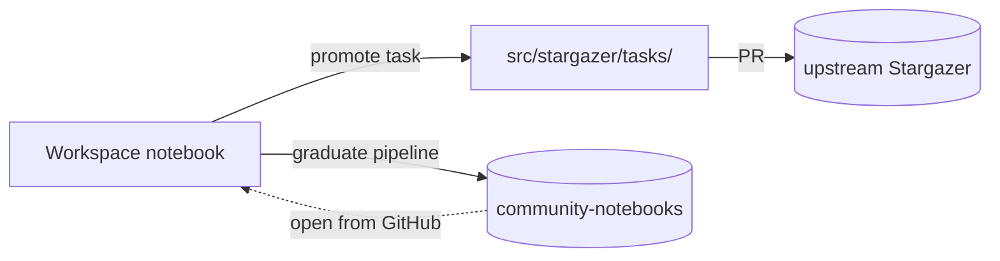

# Notebooks

The marimo notebook is Stargazer's primary user surface. Researchers think in analyses — load data, run a pipeline, look at a plot — and the notebook gives them that while everything underneath stays reproducible: the tasks a notebook calls are the same typed, versioned, image-pinned SDK code that runs in production, and where they run is a config concern, not a code change. The data they read and write is in the [asset graph](../index.md#the-asset-graph), so a notebook names its data by what it is, not where it sits.

The SDK (`src/stargazer/`) is a first-class surface too: importing tasks and authoring workflows in an IDE is a fully supported way to work. Notebooks are simply the more approachable entry point. The SDK exists so notebooks are trustworthy; notebooks exist so the SDK gets used and grown, since they are where new analyses and tasks are first written.

What runs in a notebook's pod is covered in [Notebook Runtime](runtime.md).

## Execution Context

Notebooks call `stargazer.config.init_flyte()` at startup. Opened locally, it reads `.flyte/config.yaml`; in a hosted notebook it connects to the user's own project on the cluster the notebook runs on. Whether a run goes to a cluster or stays in the notebook's own process is decided where it's started, never in the task: the same task runs either way. So one notebook spans an exploratory scratchpad (run on its own machine) to a production workflow interface (run on a cluster).

`stargazer.notebooks.ui` provides `run_location()`, a switch between *On this machine* (the default) and *On the cluster*, and `dispatch()`, which runs a task or workflow wherever the switch is set and returns its result. The Execution tutorial introduces both.

A cluster can only run tasks its pods can import: the SDK's, and those a notebook declares as top-level functions (`@app.function`). A task defined in a regular cell runs only on the notebook's own machine.

## Notebook Types

| Type | Directory | Source of truth | Purpose |
|------|-----------|-----------------|---------|
| **Tutorials** | `tutorials/` | Image-baked | Learn the building blocks, in order: Assets → Tasks → Workflows → Execution |
| **Templates** | `templates/` | Image-baked | Starting points for a new Workspace notebook (`blank`, `basic`) |
| **Community** | `<domain>/<slug>.py` | The `StargazerBio/community-notebooks` repo | Production pipelines, parameterized — bring your own data (e.g. the scRNA-seq and germline pipelines) |
| **Workspace** | — | The user's workspace store | The user's own notebooks, persisted across sessions |

Tutorials and templates are baked into the image and pinned by its release: they teach and scaffold the SDK of the same version. Community notebooks live in git, outside the image: a tutorial is read once, while a pipeline notebook is meant to be run repeatedly on new data, so it's opened into a Workspace and run from there. A user's Workspace is one folder saved whole in the [workspace store](runtime.md#the-pod-contract): notebooks side by side so they can import each other, plus any data or helper files kept beside them.

A notebook is served in **Edit** (full marimo UI) or **Run** (a read-only app view), one at a time; either mode can dispatch locally or to a cluster.

## Promotion

Work flows from experimentation toward the SDK along two paths, both starting in a Workspace notebook and happening in the repo, not on the dashboard:

**Task promotion.** Author a task in a notebook cell with the proper conventions (`@gatk_env.task`, asset types, async). Promotion moves the function into the right `src/stargazer/tasks/` subdirectory with a test, and PR review adds the polish. From there it's ordinary SDK work ([Contributing](../guides/contributing.md)).

**Workflow graduation.** A notebook that proves out a reusable pipeline first has its tasks promoted, then the notebook itself, now a thin parameterized UI over SDK calls, is published to the community repo (see [Sharing Notebooks](#sharing-notebooks)). The scRNA-seq notebook there is the template.

**Copy to workspace.** The reverse: Open from GitHub, given a link to a community notebook at a commit, drops an editable copy into the Workspace that names exactly which version it came from. The original is untouched.

Once promoted, the next image release bakes a task into every notebook, where anyone can import it.

## Boundary rules

**The SDK never imports notebooks.** Notebooks import the SDK; production code never depends on a notebook, so notebook changes can't break tasks or workflows. Notebook-to-notebook reuse is allowed: a notebook can export importable definitions via `app.setup` + `@app.function`, as the Execution tutorial does with the Workflows tutorial's workflow.

**Production notebooks get the SDK from the image.** Each notebook's PEP 723 header points at the SDK source baked into the image, so package tasks are available automatically and saved notebooks can't change which SDK they run. Locally a notebook imports your checkout. A package task run in the notebook's own process needs its domain's packages, which the SDK doesn't carry: they're in its task image, listed in the header of its domain's `env.py`, so the notebook's header lists them too (scanpy for scRNA).

## Notebook Environment

A notebook runs in the Stargazer image unless it says otherwise. That image is kept lean: the SDK, marimo and the agents, with no bioinformatics tools. A notebook adds what it needs in one of three places:

- **Python packages** go in the notebook's PEP 723 header and install when it starts, with no image to rebuild, wherever it runs.
- **System tools and the pod itself** go in the setup block as `main_env`, a `flyte.app.AppEnvironment` cloned from `notebook_env`. Its image holds system tools (`notebook_base.with_apt_packages(...)` and the other `flyte.Image` layers); its resources size the pod. The image must be built on `notebook_base`, which carries the runtime the pod needs. It's the same API production tasks and apps use, and notebooks created from the templates start with one to edit.
- **Conda packages** install from the notebook's terminal with `micromamba install <package>`, from conda-forge and bioconda, into a prefix that's on every notebook's path, the running kernel's included. They last until the container stops, or longer with a volume mounted at the prefix ([Getting Started](../getting-started.md#install-tools)).

Where the notebook runs decides which of these apply:

- **Hosted**, the pod runs `main_env`'s image, so a tool declared there is on the notebook's path, and a run in the notebook's own process can use it.
- **Locally**, `docker run` starts the Stargazer image as it is, and `main_env` isn't used. The header's packages still install, and a tool comes from conda. The container doesn't run as root, so system packages can't be added.
- **On the cluster**, a run submitted from either one runs each task in its own `TaskEnvironment`'s image, whatever the notebook's image holds.

The setup block also declares the dashboard tile's `main_name` and `main_description` as plain strings, and the tile's gear edits the whole block while the notebook is stopped. A declared image is built at launch if needed and reused after; a change takes effect the next time the notebook launches, and an environment that can't evaluate or build fails the launch with the reason. Building an image needs the hosted deployment.

## Adding Notebooks

- **Workspace notebooks** are created from the dashboard (the blank or basic template in `notebooks/templates/`) and live in the user's workspace store, with no repo change.
- **Built-in notebooks** are a `.py` file (standard marimo format, importing only public `stargazer` APIs) under `src/stargazer/notebooks/tutorials/` or `templates/`. It ships in the next release's image, and the dashboard lists it once its tile is registered there.
- **Community notebooks** are published to the community repo (below), with no release of Stargazer needed.

## Sharing Notebooks

Notebooks are code, so they're shared through git: the `StargazerBio/community-notebooks` repository holds the pipeline notebooks anyone can run, Stargazer's own included, one file per notebook, organized by topic as `<domain>/<slug>.py`.

- **Publishing is a commit.** A workspace notebook's Publish, on the dashboard, commits it to the repo under a name and domain the user picks; Unpublish deletes it, and its history stays. Anyone can also add one by hand. There's no review: the repo's CI only checks its layout.
- **Each notebook carries its metadata.** A `[tool.stargazer]` table in its script header, beside its dependencies, names who may update it. Its setup block declares its dashboard tile (`main_name`, `main_description`), as any notebook does, and imports only public `stargazer` APIs.
- **Nothing is pinned.** The repo has no lock files or image digests: a notebook runs against the SDK of the image it's opened in.
- **A catalog is the curation.** `catalog.yaml` lists the featured notebooks, each at the commit its maintainers reviewed; the rest of the repo is there to browse and open.
- **Running one** is Open from GitHub with a link to the notebook at a commit.

## In-Notebook AI

Claude Code and OpenCode ride along in the notebook editor, in marimo's agent panel: each works in the open notebook's folder in `/workspace`, with a condensed context file (`runtime/notebook_agent.md`) as `AGENTS.md`, and the editor watches the open notebook's file, so an agent's edits show up in it. marimo's terminal (Ctrl+`) has `claude` and `opencode` on its path for signing in, and a hosted pod keeps each sign-in for the user's next session. The panel and the terminal are part of the editor, not run mode. The panel's agents have the stargazer MCP server's tools (`list_tasks`, `run_task`, `query_files` and the rest of the catalog) against the user's own storage and project, and the same server serves agent users through external coding tools.

The mechanics behind this page are in the docstrings of `src/stargazer/notebooks/__init__.py` (`main_env`) and `src/stargazer/notebooks/ui.py` (dispatch).
