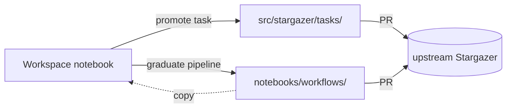
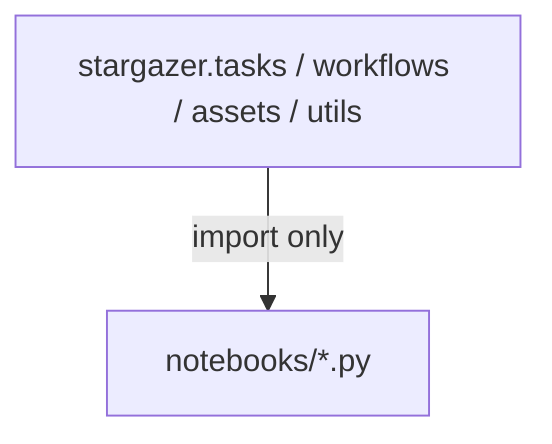

# Notebooks

The marimo notebook is Stargazer's primary user surface. Researchers often think in analyses — load data, run a pipeline, look at a plot — and the notebook gives them that experience while everything underneath stays reproducible: the tasks a notebook calls are the same typed, versioned, image-pinned SDK code that runs in production, and the execution context (local vs remote cluster) is a config concern, not a code change.

The SDK (`src/stargazer/` — assets, tasks, workflows) is a first-class surface in its own right: importing tasks and authoring workflows directly in an IDE is a perfectly legitimate way to work, and nothing about it is reserved for maintainers. Notebooks are simply the more approachable entry point — most users meet the SDK through them first. The two layers exist for each other:

- **The SDK exists so notebooks are trustworthy.** A notebook cell that calls `bwa_mem` or the scRNA pipeline is calling tested, resource-specified, container-pinned code — not a copy-pasted shell command.
- **Notebooks exist so the SDK gets used and grown.** They are where new analyses are prototyped, where new tasks are first written, and where finished work is published. Every promotion path below starts in a notebook and ends in the SDK or the repo.

This doc covers what notebooks *are* — the taxonomy, who uses them, and how work moves between notebooks and the SDK. The hosting machinery (dashboard, workspace store, pods, sign-in) is covered in [App](app.md).

## Execution Context

Where *tasks* run. Notebooks call `stargazer.config.init_flyte()` at startup. Opened locally, it reads `.flyte/config.yaml`, which names the cluster that remote runs go to. In a hosted notebook it connects to the user's own project on the cluster the notebook runs on, with no config file. Whether a run goes there or stays in the notebook's own process is decided where it's started, never in the task: the same task or workflow runs either way, unchanged. That's what lets one notebook span the whole arc: run on the notebook's own machine it's an exploratory scratchpad, and run on a cluster it's a production workflow management interface, launching, parameterizing, and tracking pipelines. The Execution tutorial makes the two underlying calls side by side.

For whoever runs a notebook, the choice is a control. `stargazer.notebooks.ui` provides `run_location()`, a two-way switch between *On this machine* (the default) and *On the cluster*, and `dispatch()`, which runs a task or workflow wherever the switch is set, waits for it, and returns its result. *On the cluster* always asks for a remote run, so with no cluster configured it fails instead of quietly running locally. The Execution tutorial ends by introducing it.

A cluster can only run tasks its pods can import: the SDK's, and those a notebook declares as reusable top-level functions (`@app.function`, the way the Execution tutorial imports the Workflows tutorial's workflow). A task defined inside a regular cell runs only on the notebook's own machine. Its environment's image has to carry what the task's module imports, as the tutorials' `tutorial_env` carries stargazer and marimo.

## Notebook Types

The dashboard renders three sections. The first two match directories under `src/stargazer/notebooks/`:

| Type | Directory | Source of truth | Mode | Purpose |
|------|-----------|-----------------|------|---------|
| **Tutorials** | `tutorials/` | Image-baked (upstream repo) | Edit | Learn the building blocks — a reading sequence: Assets → Tasks → Workflows → Execution |
| **Workflows** | `workflows/` | Image-baked (upstream repo) | Edit or Run | Production pipelines, parameterized — bring your own data (e.g. the scRNA-seq pipeline) |
| **Workspace** | — | User's workspace store | Edit or Run | The user's own notebooks — authored from scratch or a template, persisted across sessions |

Tutorials and Workflows ship in the image and work for everyone. A user's Workspace is one folder, saved whole in the [workspace store](app.md#core-concepts), keyed by their account, with no setup: the notebooks side by side at the top, so they can import each other, plus whatever data or helper files the user keeps beside them. The tile registry for image-shipped notebooks is `app/notebooks.py`; the user's own tiles are listed from the store at render time.

Tutorials and Workflows are both image-baked but differ in intent: a tutorial teaches a concept and is read once; a workflow notebook is an off-the-shelf pipeline meant to be run repeatedly against new data.

## User Archetypes

Notebook types map onto a progression. Each rung uses everything below it:

1. **Analyst** — runs Workflow notebooks against their own data, with the Tutorials as the reference for the building blocks. The image provides everything; parameters and uploads happen in the notebook UI.
2. **Author** — writes their own notebooks. Their work persists across sessions, and any notebook can be downloaded and contributed upstream.
3. **Contributor** — promotes notebook-grown code into the SDK: tasks into `src/stargazer/tasks/`, proven pipelines into `notebooks/workflows/`. Works against the repo natively — see [Contributing](../guides/contributing.md).

Orthogonal to the ladder are **SDK-native users** (authoring workflows in an IDE by importing `stargazer` tasks directly), **agent users** (driving the MCP server from Claude Code, Cursor, etc.), and **maintainers** (curating the SDK, reviewing promotions, publishing images). The same person frequently occupies several rungs in one session — the point of the design is that moving up a rung never requires abandoning the notebook.

## Promotion Paths

Work flows from experimentation toward the SDK and the public repo along two paths, both starting in a Workspace notebook. Promotion happens in the repo, not on the dashboard:

### Task promotion — notebook cell → SDK task

Researchers define tasks directly in notebook cells using proper Flyte conventions — `@gatk_env.task`, asset types, async signatures. These are real tasks that run against real data in the notebook.

1. **Author** in a notebook cell — proper decorators, structured I/O, async patterns. The task works in the notebook as-is.
2. **Promote** — mechanical extraction: strip the cell wrapper, move the function into the right `src/stargazer/tasks/` subdirectory, generate a skeleton test.
3. **Review** — a code-review agent picks up the PR and suggests changes to fit project conventions (docstrings, naming, test coverage). Convention enforcement happens at review time, not authoring time.

Researchers write a working task; promotion does the mechanical extraction; PR review adds the polish. Once a promoted task needs refinement beyond what review suggests, work continues natively against the repo like any other SDK change — see [Contributing](../guides/contributing.md).

### Workflow graduation — workspace notebook → Workflows section

A workspace notebook that proves out a *reusable* pipeline — one others should run against new data — graduates into `notebooks/workflows/`. Graduation is the composite path: first its cell-defined tasks go through task promotion (above), so the heavy lifting lives in the tested SDK; then the notebook itself — now a thin, parameterized UI over SDK calls — is PR'd into `notebooks/workflows/` and registered as a dashboard tile in `app/notebooks.py`. It ships to everyone in the next image release. The scRNA-seq pipeline notebook is the template for what a graduated workflow looks like.

### Copy to workspace — read-only source → editable notebook

The reverse of graduation: a **Copy to workspace** button on every Workflows tile drops an editable copy into the Workspace, so a shipped pipeline becomes a starting point to iterate on rather than just run. The original is untouched — the copy is a fresh notebook in the user's workspace store, free to edit or graduate. It takes the source's name, so if a notebook by that name already exists the copy is refused; rename the existing one and copy again. Mechanics in `.opencode/reference/architecture/app_internals.md`.

## The SDK Loop

Promotion is half a cycle; the other half is the SDK flowing back into notebooks:

1. Prototype a task in a Workspace notebook (it runs for real, immediately).
2. Promote it into `src/stargazer/tasks/`; it gets tests, review, and a docstring.
3. The next image release bakes it into every notebook environment.
4. Every notebook — tutorials, workflows, anyone's workspace — can now import it, and new prototypes compose it.

This loop is why the boundary and packaging rules below exist: they are what makes step 3 safe.

### Boundary rule

**The SDK never imports notebooks.** The dependency graph between the layers is strictly one-directional:

Notebooks are free to experiment, prototype, and visualize — but they are never a dependency of production code, so notebook changes cannot break tasks or workflows.

Notebook-to-notebook reuse *is* allowed: marimo notebooks can export importable definitions via `app.setup` + `@app.function`, and the Execution tutorial imports the Workflows tutorial's workflow this way rather than duplicating it. The invariant is about the SDK layer, not about notebooks sharing code among themselves.

### Packaging boundary

In production, each notebook's sandbox installs the SDK from the image's own source tree at `/stargazer` (the `[tool.uv.sources]` entry in its PEP 723 header), fixed when the image was built. This means:

- **Package tasks** in `src/stargazer/tasks/` are available in every production notebook automatically.
- **Notebook-defined tasks** run in the notebook that defines them, but are not importable elsewhere until promoted into the package.

This is a feature — it prevents untested code from silently ending up in production. Locally a notebook imports your checkout, so contributors see SDK changes as they make them. It also means saved notebooks can't change execution: the workspace store carries notebook *sources*; the SDK they import always comes from the image.

## Notebook Environment

A notebook's environment has two halves, and each has its own home:

- **Python packages** go in the notebook's PEP 723 header. They install into the notebook's own environment when it starts, with no image to rebuild, so this is where iteration stays fast.
- **System tools** (apt packages, bioconda tools, command-line binaries) go in the image the notebook runs on. A notebook declares that image in its setup block as `main_img`: a `flyte.Image` built on `notebook_base`, the standard notebook image, using any of the SDK's `Image` methods that don't copy in local files. It's the same API a production `TaskEnvironment` uses, so an environment proven in a notebook carries over to a task as-is. Notebooks created from the template start with one to edit.

The setup block also declares the pod's resources, as `main_resources = flyte.Resources(...)`, and the dashboard tile's `main_name` and `main_description`. The dashboard reads these three without running the notebook, so their values are literals: strings, and `flyte.Resources` arguments like `cpu=2` or `memory=("2Gi", "6Gi")`. A resource left out gets the default, and a resource change, like an image change, takes effect at the next launch. New notebooks start with resources declared, and the tile's gear edits the whole block from the dashboard.

At launch the declared image is built if it isn't already, and the notebook is served on it. An unchanged image is reused, so only the first launch after a change waits for a build. A change takes effect the next time the notebook launches. If the image can't be built, the launch fails with the reason instead of opening the notebook without its tools.

The `main_img` line is evaluated on its own, so it can use `flyte` and `notebook_base` but not other names from the setup block. Building needs the hosted deployment. Tutorials and workflows run on the standard image.

## Notebook Modes

How the *notebook UI* is served — orthogonal to execution context. A notebook in either mode can dispatch tasks locally or remotely.

| Mode | Behavior | Used for |
|------|----------|----------|
| **Edit** | Full marimo editing UI | Tutorials, Workflows, Workspace authoring |
| **Run** | Read-only app view (`--include-code`) | Shareable views of any notebook |

A notebook runs in one mode at a time — see [App → Core Concepts](app.md#core-concepts).

## Adding Notebooks

- **Workspace notebooks** are created from the dashboard (the blank or basic template in `notebooks/templates/`) and live in the user's workspace store — no repo change involved.
- **Tutorials and Workflow notebooks** ship in the image: add the `.py` file (standard marimo format, importing only `stargazer` public APIs) under `src/stargazer/notebooks/tutorials/` or `notebooks/workflows/`, register a tile in the `NOTEBOOKS` tuple in `app/notebooks.py`, and it lands when onboarding next builds the `notebook-app` image (`stargazer-users upgrade`).

## In-Notebook AI

**Claude Code rides along in the hosted notebook** — the proxy injects a dropdown terminal overlay (Ctrl+`) into every notebook page with the Claude Code CLI on PATH, for agentic work against the notebook's files and environment. The terminal starts in `/workspace`, and the image bakes one condensed context file, `app/notebook_agent.md`, there as `AGENTS.md`, so every session starts knowing what the pod is (what `/workspace` saves, what's lost when the pod stops), marimo's notebook conventions, Stargazer's task, asset and workflow patterns, and how a run goes local or to the cluster. Until a user edits it, it isn't saved with their workspace, so each launch gets the image's current copy. Once they edit it, their copy is saved and loaded like any of their files. The `stargazer` image seeds the same file into `/workspace` with its notebooks.

The stargazer MCP server serves agent users through external coding tools (Claude Code, Cursor, etc.), exposing `list_tasks`, `run_task`, `query_files`, and the rest of the catalog.
