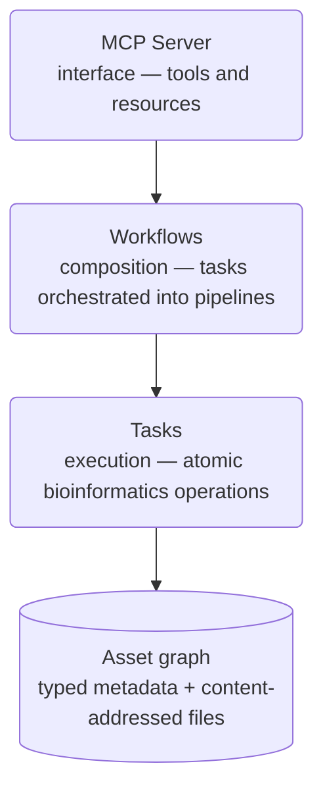

# Architecture Overview

Stargazer is organized around four layers:

The layers are enforced on imports: a module imports from its own layer or the ones below it, never above, and the lint run on every commit rejects an import that breaks this. In code, bottom up: storage (`assets`, `utils`), `tasks`, `workflows`, then the surfaces over them (the MCP server with its `registry`, and the notebooks).

## The Asset Graph

Every file is an `Asset` — a dataclass with a content identifier, where its stored bytes live (a `flyte.io.File`), and typed metadata stored as flat keyvalues. Subclasses like `Reference`, `Alignment`, and `Variants` add typed fields with automatic coercion to/from the string-valued keyvalue store.

Assets link to related files by CID: an output records the input it came from in an `{asset_key}_cid` keyvalue, and a companion, such as an index, records its primary file in `companion_of`. Calling `fetch()` on an asset downloads it and its companions. Assets and their links make up the **asset graph**.

**The asset graph is what the other layers have in common.** Tasks write into it and never see a path they didn't fetch; workflows query it with scalar parameters and never take a file; the public tier extends it across users. So a workflow runs on anyone's data that carries the metadata it asks for, which is what lets people build on each other's work without coordinating first. [The Asset Graph](../asset-graph.md) walks through it, and [Types](types.md) holds the contract and the full asset catalog.

## Tasks

Tasks are async Flyte v2 functions that receive typed assets, fetch them, run tools, and write new assets into the asset graph. Each task does one thing — align reads, sort a BAM, mark duplicates.

See [Tasks](tasks.md) for the task model.

## Workflows

Workflows are tasks that call other tasks. They accept scalar parameters, call `assemble()` to query the asset graph for their inputs, and orchestrate the pipeline. Parallel execution uses `asyncio.gather`.

See [Workflows](workflows.md) for the workflow model.

## MCP Server

The server exposes two execution paths:

- **`run_task`** — ad-hoc experimentation; the server assembles assets from filters
- **`run_workflow`** — reproducible pipelines; workflows handle their own assembly

See [MCP Server](mcp-server.md) for the full server specification.

## Interface

The marimo notebook is the primary user surface. The hosted app serves a per-user dashboard: the user's Workspace of notebooks, and an asset explorer where Stargazer's Tutorials and Workflows sit beside the user's data and the public tier. Notebooks are also where new tasks are prototyped before being promoted into the SDK. See [Notebooks](notebook.md) for the taxonomy, user archetypes, and promotion paths, and [Notebook Runtime](runtime.md) for what runs in a notebook's pod.

For local use, the same image hosted notebooks run on, **`stargazer`**, opens a Marimo notebook in edit mode for running pipelines and exploring data locally, with Claude Code or OpenCode in its agent panel — see [Notebook Runtime](runtime.md).

The MCP server runs over stdio from a source install with the `mcp` extra; any MCP client connects to `stargazer`. In the notebook, the agents in its agent panel have its tools. Tasks and workflows can also be managed directly via the [Flyte CLI](cli.md#flyte-cli). Source contributors install natively — see [Contributing](../guides/contributing.md).

## Configuration

Storage locations are set by `STARGAZER_STORE_ROOT` and `STARGAZER_INDEX_URL`; `PINATA_JWT` turns on the public tier. See [Configuration](configuration.md).
