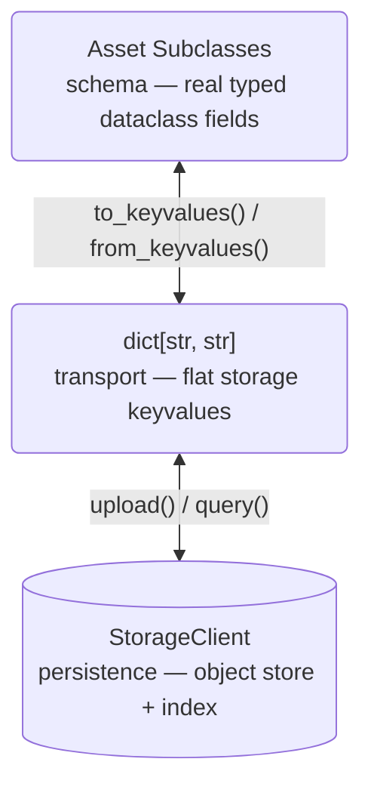

# Types and Asset System

Every file in Stargazer carries structured keyvalue metadata describing its role. That gives tools one metadata contract, lets new asset types be added without breaking old code, and lets files be found by metadata instead of path conventions.

`Asset` is both the typed schema and the storage identity. Typed fields are ordinary dataclass attributes; the flat `dict[str, str]` exists only at the storage boundary.

## Asset: The Base Class

`Asset` (`assets/asset.py`) is the dataclass every file is an instance of.

| Field | Type | Purpose |
|-------|------|---------|
| `cid` | `str` | IPFS CID of the file, computed locally from its bytes |
| `path` | `flyte.io.File \| None` | Where the stored file lives (set by `update()`); assigning a local `Path` wraps it in a File |
| `keyvalues` | `dict[str, str]` | On a typed subclass, the **extra keys** its class doesn't declare; on a bare `Asset`, all of its metadata |

Subclasses declare `_asset_key`, a unique string naming the kind, plus typed dataclass fields with defaults (`Alignment` declares `sample_id`, `duplicates_marked`, `bqsr_applied`). See [Writing a Task](../guides/writing-a-task.md) for a worked declaration. Subclasses auto-register by `_asset_key`; registration happens when the module imports, so a class defined in user code is returned by `assemble()` in any process that imports it. Assigning a field a typed subclass doesn't declare raises `AttributeError`, catching metadata typos at write time.

**Extra keys.** A typed asset can carry keyvalues its class doesn't declare, as strings in `keyvalues`: an `Alignment` tagged `lane=3` stays an `Alignment`, and `assemble(lane="3")` finds it. Extras ride along between tasks, into the index and back through `assemble()`. A key is either a declared field or an extra, never both.

**Serialization.** `str` fields pass through unchanged; everything else round-trips through JSON (`True` → `"true"`, `12` → `"12"`, a list → a JSON array).

**The catchall.** A bare `Asset` (no `_asset_key`) carries a free-form `keyvalues` dict, for kinds of file no class describes yet. When a matching subclass is later defined, those records type-promote on the next query.

**Validation.** `build_asset(keyvalues)` is the one place that decides typed versus generic for incoming metadata, shared by the MCP server and the dashboard's asset page. It requires an `asset` key and rejects reserved `_`-prefixed keys.

**Ownership.** `_owner` is a reserved keyvalue stamped automatically from `STARGAZER_OWNER` for attribution; users never type it. It records who made a record and decides which public companions `fetch()` takes. It grants or denies nothing else.

### Core Methods

- `fetch()` — downloads self, then every companion into the same directory; returns the local path
- `update(path, **kwargs)` — sets the given attributes, stores the file, and sets `cid` and `path`
- `to_dict()` / `from_dict()` — JSON serialization
- `declared_fields()` — the names of the fields a type declares

See the [Catalog](../reference/catalog.md#asset-types) for every registered asset type.

## Companions

A companion is a file a tool expects beside another, such as an index or a sequence dictionary. It records its primary file's CID in `companion_of`, and `fetch()` downloads it into the same directory so tools find an index next to its file. `Reference(cid="bafk…").fetch()` also brings every `ReferenceIndex`, `SequenceDict` and `AlignerIndex` with `companion_of="bafk…"`; any asset with `companion_of` set is one. Where companions are looked for is in [Configuration](configuration.md#writing-and-reading).

`companion_of` is the only link `fetch()` follows. Fields like `reference_cid` and `source_cid` are provenance: `assemble(reference_cid=…)` finds every alignment made against a reference, and `fetch()` leaves them behind.

## Assembly

`assemble(**filters)` queries storage by keyvalue, deduplicates by CID, and returns a flat `list[Asset]` of specialized subclass instances. Every filter must match exactly; a list value matches any of its entries. Workflows filter the result with `isinstance` to pick out the types they need ([Writing a Workflow](../guides/writing-a-workflow.md)).

Records come back through `specialize(record)`, which is graceful at query time: an unregistered key, or a record whose values don't parse against its class, falls back to a bare `Asset` instead of raising, so one malformed record can't crash an `assemble()`.

## Storage Layer

`utils/storage.py` defines `StorageClient`, the one storage interface. Bytes go to the object store, metadata to the index (one row per CID), public data joins queries from Pinata when `PINATA_JWT` is set, and a local cache sits in front of downloads. The CID comes from `utils/cid.py`, which builds the same UnixFS DAG Pinata does, so identity never depends on where a file is stored. Locations and settings are in [Configuration](configuration.md).

Tasks never call storage directly. All storage interaction flows through `Asset.fetch()`, `Asset.update()` and `assemble()`.
