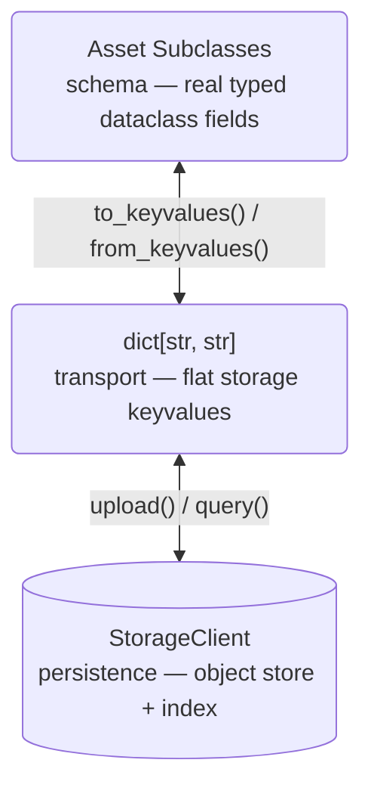

# Types and Asset System

## Design Goals

Every file in Stargazer carries structured keyvalue metadata that describes its role, enabling:

- **Consistency**: All tools produce and consume files through the same metadata contract
- **Extensibility**: New asset types and metadata fields can be added without breaking existing code
- **Queryability**: Files can be discovered and filtered by metadata without path conventions
- **Companion linking**: A file a tool needs beside another (e.g. index + primary) names it by CID in `companion_of`

## Architecture

There is no separate "storage primitive" layer. `Asset` is both the typed schema and the storage identity. Typed fields are ordinary dataclass attributes; the flat `dict[str, str]` exists only at the storage boundary, produced and consumed by `to_keyvalues()` / `from_keyvalues()`.

## Asset: The Base Class

`Asset` (`assets/asset.py`) is a single dataclass for all typed file assets. Every file in the system is an Asset instance.

| Field | Type | Purpose |
|-------|------|---------|
| `cid` | `str` | IPFS CID of the file, computed locally from its bytes |
| `path` | `flyte.io.File \| None` | Where the stored file lives (set by `update()`); assigning a local `Path` wraps it in a File |
| `keyvalues` | `dict[str, str]` | On a typed subclass, the **extra keys** its class doesn't declare (see [Extra keys](#extra-keys)); on a bare `Asset`, all of its metadata (see Catchall below) |

### Subclass Declaration

Subclasses declare `_asset_key` — a unique string identifying the asset kind — plus ordinary typed dataclass fields with defaults (e.g. `Alignment` declares `sample_id`, `duplicates_marked`, `bqsr_applied`). See [Writing a Task](../guides/writing-a-task.md) for a worked declaration. Subclasses auto-register in `Asset._registry` (via `__init_subclass__`), which maps `_asset_key` strings to their class. Registration is import-driven and per-process: a class defined in user code registers the moment its module imports, so `assemble()` returns it in any process that imports it.

`__setattr__` **enforces** the declared schema on typed subclasses — assigning a field the dataclass doesn't declare raises `AttributeError`, catching metadata typos in task code at write time. On a bare `Asset` (no `_asset_key`) it passes through. Attributes are strict; `keyvalues` is not: a key the class doesn't declare goes in `keyvalues` explicitly.

### Extra keys

**A typed asset can carry keyvalues its class doesn't declare**, as strings in `keyvalues`. An `Alignment` tagged `lane=3` stays an `Alignment`, so every task that takes one can still be handed it, and `assemble(lane="3")` finds it. Declared fields keep their types and their checks; extras have no type to check, so they're stored and returned exactly as given. If a class later declares that key, the stored value is parsed into the field on the next query, the same way bare records type-promote.

A key is either a declared field or an extra, never both: `from_keyvalues()` splits a record so the two can't overlap, and `to_keyvalues()` raises if code puts `asset` or a declared field into `keyvalues` by hand. A record read back from storage carries its stamped `_owner` among the extras, as a bare `Asset` does.

Extras ride along wherever the asset goes: between tasks (Flyte serializes the dataclass, `keyvalues` included), into the index, and back through `assemble()`. A task that builds a new asset from an input copies only the fields it sets, so an input's extras don't pass to its outputs. The user's own index stores any number of extras; a file uploaded to the public tier is limited by [Pinata's keyvalue cap](configuration.md#pinata-upload-paths).

### Serialization

`to_keyvalues()` / `from_keyvalues()` convert between typed fields and the flat `dict[str, str]` storage carries:

- `str` fields pass through unchanged.
- All other types round-trip via `json.dumps` / `json.loads` (`bool` → `"true"`, `int` → `"12"`, `list` → JSON array).

A typed asset's extra keys are written beside its declared fields. `from_keyvalues()` raises on a declared non-`str` value that doesn't parse; callers that must tolerate malformed records catch it (see [Specialization](#specialization)).

### Catchall: bare `Asset`

A bare `Asset` (no `_asset_key`) carries a free-form `keyvalues` dict, serialized **verbatim** (the `asset` key lives inside it). **It is for kinds of file no class describes yet**, not for adding fields to a kind that has one: an extra field goes on the typed asset (see [Extra keys](#extra-keys)). Only the `asset` key is required, and no field schema is enforced. When a user later defines a matching `Asset` subclass, those records type-promote on the next query.

### Validation: `build_asset()`

`build_asset(keyvalues)` (`assets/__init__.py`) is the single validation choke point shared by the MCP server (`upload_file`, `update_file`) and the admin asset page (`/assets/sign` uploads and `/assets/update` metadata edits). It requires an `asset` key, rejects reserved `_`-prefixed keys (stamped automatically — see Ownership), builds a registered key's class (declared fields must parse to their types; any other key becomes an extra), and builds a bare `Asset` for unregistered keys. One place decides typed-vs-generic so the page and the SDK never drift.

### Ownership (`_owner`)

`_owner` is a reserved keyvalue stamped automatically for attribution — never typed by users (`build_asset()` rejects `_*` keys). The storage client stamps it from `STARGAZER_OWNER` on every index row it writes (`upload()` and `update_metadata()`), and `PinataClient` on public uploads; the env wins over any stale value, and with it unset nothing is stamped. The asset page stamps the signed-in user. It records who made a record; it grants or denies nothing, and on Pinata's public network anyone holding the key can edit or delete any record. Hosted-deployment plumbing is in [App → Asset Manager](app.md#asset-manager).

### Core Methods

- `fetch()` — downloads self, then every asset with `companion_of = self.cid` into the same directory; returns the local path
- `update(path, **kwargs)` — sets the given attributes, stores the file, and sets `cid` and `path`
- `to_dict()` / `from_dict()` — JSON serialization

## Asset Subclass Catalog

See the [Catalog](../reference/catalog.md#asset-types) for a complete list of registered asset types.

## Companion Pattern

A companion is a file a tool expects beside another, such as an index or a sequence dictionary. It records that file's CID in its `companion_of` keyvalue. When `fetch()` is called on an asset:

1. Downloads the asset itself
2. Queries for assets whose `companion_of` equals this asset's CID
3. Downloads them into the same directory, so tools find an index next to its file
4. Returns the asset's local path

Example: `Reference(cid="bafk…").fetch()` also finds and downloads every `ReferenceIndex`, `SequenceDict` and `AlignerIndex` with `companion_of="bafk…"`. The typed companions are `AlignmentIndex`, `ReferenceIndex`, `SequenceDict`, `AlignerIndex`, `VariantsIndex` and `KnownSitesIndex`, but any asset with `companion_of` set is one, a bare `Asset` included.

`companion_of` is the only link `fetch()` follows. The `{asset_key}_cid` fields and `source_cid` record which input an output was made from — `reference_cid` and `r1_cid` on an `Alignment`, `alignment_cid` on a `BQSRReport`. That's provenance: `assemble(reference_cid=…)` finds every alignment made against a reference, and `fetch()` leaves them behind. Reads link their mate through `mate_cid`, which is neither.

## Assembly

`assemble(**filters)` is a module-level async function in `assets/asset.py`. It queries storage with keyvalue filters, deduplicates by CID, and returns a flat `list[Asset]` of specialized subclass instances.

Every filter must match exactly. A list value matches any of its entries, in a single query (the `asset` key accepts a list too).

Workflows filter the returned list with `isinstance` to pick out the types they need — see [Writing a Workflow](../guides/writing-a-workflow.md).

## Specialization

`specialize(record)` in `assets/__init__.py` converts a raw storage record to its registered subclass by looking up `keyvalues["asset"]` in `Asset._registry`. Keys the class doesn't declare come back as its extras. It is **graceful at query time** (the mirror of `build_asset()` being strict at write time): an unregistered key, or a record whose declared values don't parse against the registered class, falls back to a bare `Asset` carrying the keyvalues verbatim rather than raising — so one malformed legacy record can't crash a whole `assemble()`.

## Storage Layer

`utils/storage.py` defines `StorageClient`, the one storage interface: `upload()`, `download()`, `query()`, `get()`, `delete()` and `update_metadata()`. The module-level `default_client` is built lazily from the environment, so it sees credentials Flyte injects just before a task runs.

- **Bytes** go to the object store at `<store root>/users/<owner>/assets/<cid>/<name>`.
- **Metadata** goes to the index (`utils/index.py`), one row per CID; on Union the user's dashboard owns it.
- **Public data** joins queries from Pinata's public network when `PINATA_JWT` is set.
- **The cache** at `<STARGAZER_LOCAL>/<cid>/<name>` sits in front of downloads.

The CID comes from `utils/cid.py`, which builds the same UnixFS DAG Pinata does, so identity never depends on where a file is stored. Locations and settings are in [Configuration](configuration.md).

Tasks never call storage directly. All storage interaction flows through `Asset.fetch()`, `Asset.update()` and `assemble()`.
