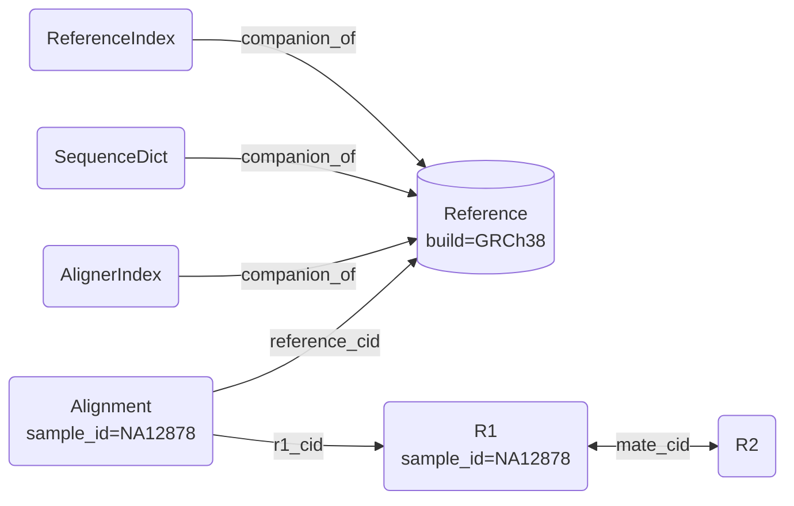

# The Asset Graph

Every file in Stargazer is an asset, and every asset says what it is: its content-derived ID, its type, typed fields such as `sample_id` or `build`, and links to the assets it relates to. Those assets and links are the **asset graph**. Tasks write into it, workflows query it, and anyone who publishes to it extends everyone else's.

## Nodes and edges

A node is an asset. Its **CID** is computed from its bytes, so the same file has the same ID wherever it's stored. Its **type** (`Reference`, `Alignment`, `AnnData` or one you define) gives it typed fields, and it can carry extra keys its type doesn't declare.

An edge is a field holding another asset's CID. There are two kinds:

| Edge | Means | What follows it |
|------|-------|-----------------|
| `companion_of` | This file belongs beside that one, as an index belongs beside its FASTA | `fetch()` brings companions along into the same directory |
| `<asset>_cid`, such as `reference_cid` or `source_cid` | This file was made from that one | `assemble(reference_cid=...)` finds everything made from it |

A slice of the graph after aligning one sample:



The hosted dashboard's asset explorer draws the graph this way, with your assets, Stargazer's and the public ones side by side.

## Tasks write the graph

A task takes typed assets, calls `fetch()` on each to get a local path (with its companions beside it), runs its tool, and stores what it made with `update()`. The output goes into the graph with its type, its fields and a link to what it was made from. Nothing else files it, and it can be found the moment the task returns:

```python
from stargazer.assets.asset import assemble

alignments = await assemble(asset="alignment", reference_cid=ref.cid)
```

**Every run grows the graph**, and the next query sees what it added. How to declare the links on a new output type is in [Writing a Task](guides/writing-a-task.md).

## Workflows query the graph

A workflow takes plain parameters, not files, and asks the graph for its inputs:

```python
from stargazer.workflows import germline_short_variant_discovery

vcf = await germline_short_variant_discovery(
    build="GRCh38", sample_ids=["NA12878", "NA12891"]
)
```

Inside, it calls `assemble(build="GRCh38", asset="reference")` and `assemble(sample_id=..., asset=["r1", "r2"])`, and passes the typed assets it gets back from task to task. It doesn't matter whether you uploaded the reads, a bundle brought in the reference or a colleague published either one. Running it on new samples means passing new IDs. [Writing a Workflow](guides/writing-a-workflow.md) covers the pattern, and the Execution tutorial shows a notebook sending a call like this to a cluster.

The pairing is what makes both sides simple. **Tasks get strong types, and workflows get flexible inputs.** The types between tasks are checked at every task boundary, and the only thing a workflow commits to is the metadata it asks for.

## The graph is open

The graph grows with your work, not ahead of it.

- **Extra keys.** Any asset can carry keys its type doesn't declare, and they're queryable like declared ones:

    ```python
    from pathlib import Path

    from stargazer.assets import R1

    r1 = R1()
    r1.keyvalues["lane"] = "3"
    await r1.update(Path("reads/NA12878_L3_R1.fq.gz"), sample_id="NA12878")

    lane_3 = await assemble(asset="r1", lane="3")
    ```

- **New types anywhere.** A type defined in a notebook cell is in the graph as soon as the cell runs, and any process that imports it gets typed assets back from `assemble()`. The Assets tutorial defines one.
- **Files no type describes yet.** A bare `Asset` holds free-form metadata. When someone defines a matching type later, those records come back as that type on the next query.
- **Types that change.** Every field has a default, so records written before a field existed still load.

## Identity outlives location

An asset's CID is its identity, and where its bytes live is a detail `fetch()` resolves. The same file has the same CID on your laptop, in a cloud bucket and on the public network, and publishing it keeps the CID. So a notebook that names an asset by CID reads the same bytes for anyone who opens it, a run's recorded input CIDs replay it on exactly what it read, and identical files are stored once.

## Collaboration without coordination

Sharing analysis usually takes coordination: agreeing on folder layouts and file names, sending data and pipeline separately, and rewiring paths on the other side. In Stargazer the asset graph is the shared contract. A workflow asks for `build="GRCh38"`, and any reference published with that metadata answers it. Nothing else needs agreeing first.

- **Publishing joins the public graph.** A published asset keeps its CID and metadata, and with the public tier on, everyone's `assemble()` includes it beside their own assets, their own copy winning when both have one. Your name goes on it as its owner.
- **Work done once travels.** Publish a reference's indices beside it, and anyone who fetches that reference without indices of their own gets yours. Public indices come only from whoever published the reference, so builds from different publishers never mix.
- **Outputs link back to what they used.** A colleague's alignment against your published reference records your reference's CID, so the graph shows what was built on it.
- **Notebooks are in the graph too.** A published notebook is an asset anyone can find and copy into their workspace. Since it asks the graph for its data, it runs against theirs unchanged.
- **Tasks grow the shared SDK.** A task written in a notebook can be promoted into Stargazer and ships in the next image, where every notebook can import it ([Notebooks → Promotion](architecture/notebook.md#promotion)).

Publishing is one call, from a notebook, the SDK or an agent's `publish_file` tool:

```python
from stargazer.utils.storage import default_client

await default_client.publish(ref.cid)
```

How to turn on the public tier and who can publish is in [Configuration](architecture/configuration.md#the-public-tier). The full asset contract is in [Types and Asset System](architecture/types.md).
