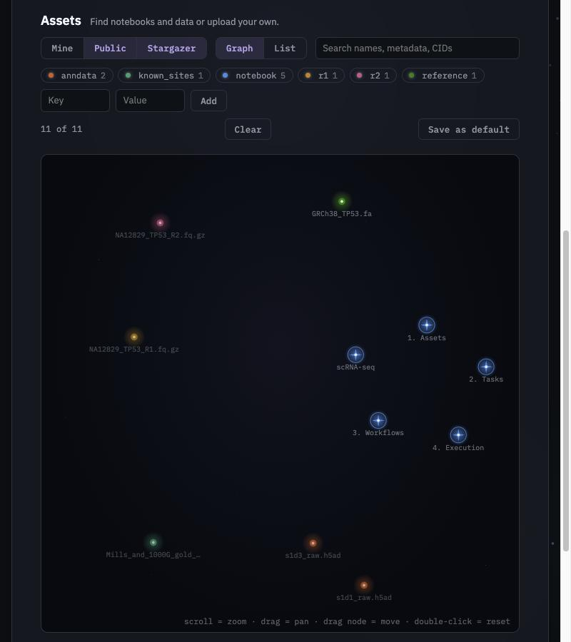

# Getting Started

Stargazer runs in two places. **Hosted**, you sign in and get a workspace of notebooks with a cluster behind it. **Locally**, one Docker image, **`stargazer`**, runs the same notebooks on your machine. The SDK installs as a Python package (`stargazer-bio`) for authoring in an IDE.

If you want to add tasks or workflows to Stargazer itself, see [Contributing](guides/contributing.md) for the native setup.

## Hosted

Sign in at [stargazer.bio/login](https://stargazer.bio/login) with GitHub, and you land on your dashboard. Hosted workspaces are set up by invitation. The first visit after an idle hour shows an *Opening your workspace* page for about a minute while it starts.

The dashboard has two halves:

- **Workspace**: your own notebooks. Start one from the blank or basic template, or open a `.py` notebook from a GitHub link. Each opens in **Edit**, the full editor with a terminal and the agents, or **Run**, the notebook as an app.
- **Assets**: your asset graph, as a graph or a list, with the Tutorials and Workflows notebooks and public data beside your own files. Upload files here to store them as assets.



Your workspace is saved as you work, every 30 seconds and when a notebook stops, and comes back the next time you open it. A file over 100 MB in the workspace isn't saved: a banner names it, with a cell that stores it as an asset instead. **"On the cluster" runs go to your own project**, and your files are reachable only by your own notebooks and runs.

## Run It Locally

```bash
docker run -p 8080:8080 ghcr.io/stargazerbio/stargazer
```

Serves [Marimo](https://marimo.io/) notebooks at `http://localhost:8080` in edit mode, opening on the Assets tutorial. The rest are in the file explorer, in a `notebooks/` folder: `tutorials/`, in reading order Assets, Tasks, Workflows and Execution, and `templates/` with `blank.py` and `basic.py` to start your own from. Start a notebook of your own by copying a template rather than with marimo's *Create a new notebook*, whose notebooks don't have Stargazer installed. Pipeline notebooks, such as scRNA-seq clustering and germline variant calling, live in the [community notebooks](https://github.com/StargazerBio/community-notebooks) repository; download one into the mounted directory below to run it. This is the same image hosted notebooks run on (see [Notebooks](architecture/notebook.md) and [Notebook Runtime](architecture/runtime.md)).

## Use Your Own Files

Mount a directory at `/workspace`, the notebook's working directory:

```bash
docker run -p 8080:8080 -v "$PWD/data":/workspace ghcr.io/stargazerbio/stargazer
```

Its files show up in the notebook's file explorer and its terminal, so a notebook reads them by relative path (`pd.read_csv("reads/sample.csv")`). The `notebooks/` folder is copied there at start, skipping files the directory already has, so your edits are kept. On Linux the container runs as user 1000, so the directory must be writable by that user.

To keep assets between runs, mount a volume at `/home/flyte/.stargazer`, which holds the asset store, its index and the download cache:

```bash
docker run -p 8080:8080 -v stargazer-data:/home/flyte/.stargazer ghcr.io/stargazerbio/stargazer
```

A file in `/workspace` isn't in the [asset graph](index.md#the-asset-graph) until a notebook stores it with `await asset.update(path, ...)`; after that `assemble()` finds it by its metadata and `fetch()` copies it into the download cache. The Assets tutorial walks through it. To keep assets somewhere else, set `STARGAZER_STORE_ROOT` and `STARGAZER_INDEX_URL` (see Configuration below).

## Packages and Tools

A notebook lists what it needs in its header, the `# /// script` block at the top, and it installs when the notebook opens, hosted or locally. Python packages go in `dependencies`. Command-line tools, such as samtools or GATK, come from conda: list them under `[tool.pixi.dependencies]`, with bioconda among the channels:

```python
# /// script
# requires-python = ">=3.14"
# dependencies = [
#   "marimo",
#   "stargazer-bio",
# ]
#
# [tool.pixi.workspace]
# channels = ["conda-forge", "bioconda"]
#
# [tool.pixi.dependencies]
# python = "3.14.*"
# samtools = "1.*"
#
# [tool.pixi.pypi-dependencies]
# stargazer-bio = { path = "/stargazer", editable = true }
# ///
```

Each notebook gets its own environment, so the tool is on that notebook's path. The last line points the SDK at the copy in the image; keep it, and the `python` pin.

## Agents — Claude Code and OpenCode in the Notebook

Press ++ctrl+grave++ in the notebook to open its terminal and sign in once: run `claude` for Claude Code, or `opencode auth login` for OpenCode. Then open the AI panel from the sidebar, switch to **Agents** and start a new Claude or OpenCode session. A hosted notebook keeps your sign-in for your next session; the local image keeps it until the container stops. The agent works in the open notebook's folder, with the Stargazer SDK installed at `/stargazer`, and it can add the command-line tools a notebook needs to its header. It also has Stargazer's own tools, which list the tasks and workflows, run them, and find, upload and tag your files. When it edits the open notebook, the changed cells show up in the editor, ready to run. The terminal and the agent are part of the editor, so a notebook opened to run has neither.

## MCP Client Configuration

The MCP server runs from a source install with the `mcp` extra. Point your MCP client (Claude Code, OpenCode, Cursor) at the `stargazer` command; the config is in [Using the MCP Server](guides/mcp-server.md#connecting-a-client).

## Configuration

Set environment variables to control storage behavior (with `-e` for a container):

| Setup | What to set |
|-------|-------------|
| **Default** — your files stored under `~/.stargazer` (inside the container, for an image), public datasets fetched by CID | Nothing |
| **Shared public data** — search public datasets by metadata | `PINATA_JWT` |
| **Your own storage location** — keep files elsewhere, or in a bucket | `STARGAZER_STORE_ROOT`, `STARGAZER_INDEX_URL` |

```bash
docker run -p 8080:8080 -e PINATA_JWT=your_jwt ghcr.io/stargazerbio/stargazer:latest
```

See [Configuration](architecture/configuration.md) for details.

## Installing from Source

**Prerequisites:** Python 3.14+, [uv](https://docs.astral.sh/uv/)

```bash
git clone https://github.com/StargazerBio/stargazer.git
cd stargazer
uv pip install -e ".[mcp]"
stargazer
```

`stargazer` serves MCP over stdio; add the `bio` extra to run the scRNA-seq tasks locally, and `notebook` for the notebooks.

## Docs

To preview documentation locally:

```bash
uv run python docs/gen_catalog.py
uv run zensical serve
```
