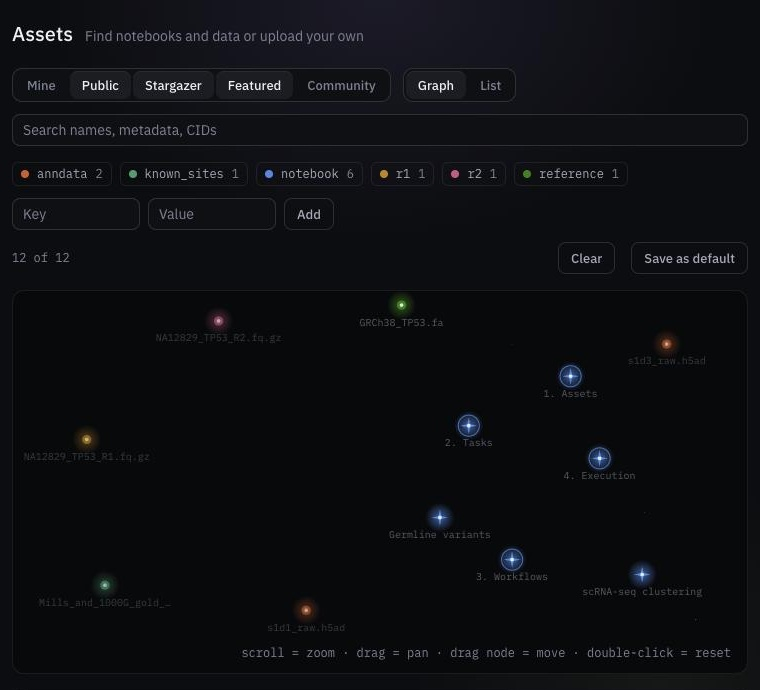

# Getting Started

Stargazer runs in two places. **Hosted**, you sign in and get a workspace of notebooks with a cluster behind it. **Locally**, one Docker image, **`stargazer`**, runs the same notebooks on your machine.

## Hosted

Sign in at [stargazer.bio/login](https://stargazer.bio/login) with GitHub, and you land on your dashboard. Hosted workspaces are set up by invitation. The first visit after an idle hour shows an *Opening your workspace* page for about a minute while it starts.

The dashboard has two halves:

- **Workspace**: your own notebooks. Start one from the blank or basic template, or open a `.py` notebook from a GitHub link. Each opens in **Edit**, the full editor with a terminal and the agents, or **Run**, the notebook as an app.
- **Assets**: your asset graph, as a graph or a list, with the Tutorials and Workflows notebooks and public data beside your own files. Upload files here to store them as assets.



Your workspace is saved as you work, every 30 seconds and when a notebook stops, and comes back the next time you open it. A file over 100 MB in the workspace isn't saved: a banner names it, with a cell that stores it as an asset instead. **"On the cluster" runs go to your own project**, and your files are reachable only by your own notebooks and runs.

## Run It Locally

```bash
docker run -p 8080:8080 ghcr.io/stargazerbio/stargazer
```

Serves [Marimo](https://marimo.io/) notebooks at `http://localhost:8080` in edit mode, opening on the Assets tutorial. The rest are in the file explorer, in a `notebooks/` folder: `tutorials/`, and `templates/` with `blank.py` and `basic.py` to start your own from. Start a notebook of your own by copying a template rather than with marimo's *Create a new notebook*, whose notebooks don't have Stargazer installed. Pipeline notebooks, such as scRNA-seq clustering and germline variant calling, live in the [community notebooks](https://github.com/StargazerBio/community-notebooks) repository; download one into the mounted directory below to run it. This is the same image hosted notebooks run on.

## Use Your Own Files

Mount a directory at `/workspace`, the notebook's working directory:

```bash
docker run -p 8080:8080 -v "$PWD/data":/workspace ghcr.io/stargazerbio/stargazer
```

Its files show up in the notebook's file explorer and its terminal, so a notebook reads them by relative path (`pd.read_csv("reads/sample.csv")`). The `notebooks/` folder is copied there at start, skipping files the directory already has, so your edits are kept. On Linux the container runs as user 1000, so the directory must be writable by that user.

To keep assets between runs, mount a volume at `/home/flyte/.stargazer`, which holds the asset store, its index and the download cache:

```bash
docker run -p 8080:8080 -v stargazer-data:/home/flyte/.stargazer ghcr.io/stargazerbio/stargazer
```

A file in `/workspace` isn't in the [asset graph](index.md#the-asset-graph) until a notebook stores it with `await SomeAsset.store(path, ...)`; after that `assemble()` finds it by its metadata and `fetch()` copies it into the download cache. The Assets tutorial walks through it. To keep assets somewhere else, or to search the public tier, pass the variables in [Configuration](architecture/configuration.md#environment-variables) with `-e`.

## Where to Go Next

The tutorials build on each other, so read them in order. Hosted, they're in the Assets view; locally, in `notebooks/tutorials/`.

1. **Assets**: why assets are typed, what each one holds, and defining your own.
2. **Tasks**: a task that takes that asset, and where its environment lives.
3. **Workflows**: that task fanned out across cohorts in a workflow.
4. **Execution**: the same workflow run on this machine, then on the cluster.

When a notebook needs a package or a command-line tool, [Where Your Code Runs](guides/where-your-code-runs.md) covers its header. [Agents in the Notebook](guides/notebook-agents.md) sets up Claude Code and OpenCode in the editor. To write tasks and workflows in an IDE, install the SDK (`pip install stargazer-bio`) and start from [Writing a Task](guides/writing-a-task.md); to connect another MCP client, see [Using the MCP Server](guides/mcp-server.md). To work on Stargazer's own source, see [Contributing](guides/contributing.md).
