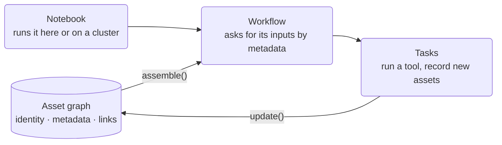

# Stargazer

**In Stargazer, data knows what it is.** Every file is an asset: a content-derived identity, typed metadata saying what the file holds, and links to the files it was made from and the files that belong beside it. Together those assets and links form the **asset graph**, and everything else in Stargazer reads from it and writes back into it.

Tasks take assets in and put new assets into the graph. Workflows ask the graph for their inputs by what they are, not where they sit. Notebooks drive both, and a cluster runs them. Because the graph sits between every piece of work, you can share data and workflows without lining up paths, formats or folder layouts with anyone first. That's **collaboration without coordination**.

## What the asset graph gives you

- **Workflows take questions, not files.** The germline pipeline is called with a reference build and sample IDs. It finds the reference, its indices and each sample's reads in the graph, whether you uploaded them, a bundle brought them in or someone published them.
- **Every run grows the graph.** An output is stored with typed metadata and a link to what it was made from, so it can be found as soon as it exists. Nobody files it, and the next query sees it.
- **The graph grows with your work.** Tag any asset with a key its type doesn't declare and query on it. Define a new asset type in a notebook cell and it's in the graph straight away. Older records keep working as types gain fields.
- **Identity outlives location.** An asset's ID comes from its bytes, so it's the same on your laptop, in a cloud bucket and on the public network. A notebook that names an asset by ID works for anyone, wherever the bytes are held.
- **Collaboration without coordination.** Publish an asset and it joins the public graph, with your name on it. A colleague's workflow finds it by the same metadata it would use for their own data, and their outputs link back to it.

[The Asset Graph](asset-graph.md) shows each of these with code.

## Production workflows from a cell

The tasks a notebook calls are the same typed, versioned, containerized code that runs in production. Each task's image and resources are declared with it, so a workflow that fans out across a thousand samples runs on a cluster from one cell, and the same call runs on your own machine while you explore. Where it runs is chosen where you start it, never in the code.

## Interface

The marimo notebook is the primary user surface: the hosted app serves per-user notebooks for learning, running pipelines and authoring (see [Notebooks](architecture/notebook.md)). Each release publishes one image, **`stargazer`**, which runs the same notebooks locally, with Claude Code or OpenCode in the notebook's agent panel. The SDK is a first-class surface too: import its tasks and author workflows in an IDE.

The MCP server gives any MCP-compatible client (Claude Code, OpenCode, Cursor) the same tasks, workflows and asset graph, and its tools are in the notebook's agent panel. Source contributors work natively against the repo; see [Contributing](guides/contributing.md).

## Documentation

- [The Asset Graph](asset-graph.md): what the graph is, and how tasks, workflows and collaborators use it
- [Getting Started](getting-started.md): from zero to your first workflow
- [Architecture](architecture/overview.md): how the system is designed and why
- [Guides](guides/writing-a-task.md): step-by-step walkthroughs for common work
- [Contributing](guides/contributing.md): set up a dev environment and run tests
- [API Reference](reference/api.md): generated from docstrings
