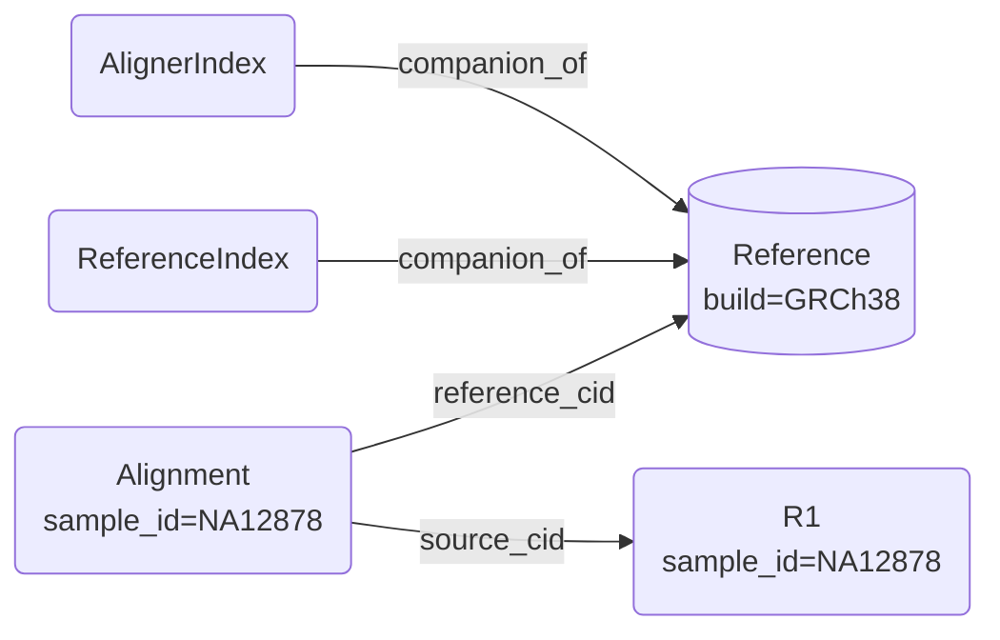

# Stargazer

**The perpetual progress machine for computational biology.** Stargazer is an open-science project to broaden access to bioinformatics tools, foster collaboration and align incentives in service of biomedical progress.

## Why Stargazer

**LLMs have made computational techniques reachable for every researcher, but they've left reproducibility to the vagaries of prompting.** Writing an analysis by hand used to force every parameter and tool choice into code that could be rerun; an analysis built in a chat often keeps that record nowhere. Meanwhile, data arrives faster than it can be analyzed, let alone re-analyzed as new work is published, and the tools and download links behind published results go stale.

Stargazer keeps the low barrier and restores the record. The analysis you build, with or without an agent, is typed, containerized code over data that's identified by its content, so it runs again for anyone, on anything that matches what it asks for.

## How it works

Ask Stargazer to align WGS reads against GRCh38 with BWA-MEM2, and it will:

1. **Resolve the data.** The reference, its indices and the reads come from the [asset graph](#the-asset-graph) by their metadata, not by file path.
2. **Compose the workflow.** It assembles the SDK's tasks, or writes new ones, each with typed inputs and outputs, the resources it needs and an image with its tools.
3. **Run it where you choose.** The same code runs in the notebook or on a cluster, through [Flyte](#orchestration).
4. **Return assets.** Outputs land back in the asset graph with a link to what they were made from, ready to inspect now or build on later.

## Production-grade notebooks

**A marimo notebook is the interface, and the code in it is production code.** The tasks a notebook calls are the same typed, versioned, containerized code that runs at scale, so **where a run goes is a switch in the notebook, never a change to the code**:

```python
where = run_location()  # "On this machine" | "On the cluster"

results = await asyncio.gather(*(dispatch(where, qc_filter, adata=a) for a in samples))
```

On this machine, that cell runs in the notebook's own process. On the cluster, it fans each sample out to its own pod with the image and hardware its task asked for, and returns typed assets either way.

- **An agent works beside you.** The notebook's agent panel runs Claude Code or OpenCode, primed with Stargazer's conventions and connected to its tasks, workflows and your assets through the MCP server. Describe what you want and it writes cells that follow the same patterns the SDK does.
- **One notebook spans the whole range**, from a scratchpad on a slice of data to the front end for a full cohort. Served in run mode, it's an app driven by the controls you built while exploring.
- **Tasks promote into the SDK.** A task written in a notebook can move into Stargazer, ship in the next image and be imported by every notebook and workflow ([Notebooks → Promotion](architecture/notebook.md#promotion)).
- **Notebooks travel as code.** A notebook in any GitHub repo opens into your workspace and, since it asks the asset graph for its data, runs against yours unchanged.

The SDK is a first-class surface too: import its tasks and author workflows in an IDE. [Notebooks](architecture/notebook.md) covers how notebooks are served and run.

## Orchestration

**[Flyte V2](https://www.union.ai/docs/v2/flyte/user-guide/overview/) does the heavy lifting**: pure Python, async-native orchestration. Every task runs in a container, with its resources and dependencies declared beside its code. Workflows are tasks that call tasks, so they nest arbitrarily and run in parallel with plain `asyncio.gather`. Types are enforced at every task boundary, so what goes in and comes out of each step is checked and recorded. [Tasks](architecture/tasks.md) and [Workflows](architecture/workflows.md) cover the model.

## The asset graph

**Every file is an asset**: an ID computed from its bytes, a type with typed fields such as `sample_id` or `build`, and links to the assets it relates to. Those assets and links are the asset graph. Tasks write into it and workflows query it.



A `companion_of` link means "belongs beside", the way an index belongs beside its FASTA, and `fetch()` brings companions along into the same directory. An `<asset>_cid` link means "made from", and `assemble(reference_cid=ref.cid)` finds everything made from that reference.

- **Workflows take questions, not files.** The germline pipeline is called with a build and sample IDs, and finds the reference, its indices and each sample's reads in the graph, wherever they came from.

    ```python
    vcf = await germline_short_variant_discovery(
        build="GRCh38", sample_ids=["NA12878", "NA12891"]
    )
    ```

    The [germline notebook](https://github.com/StargazerBio/community-notebooks/blob/main/germline/short-variant-discovery.py) runs it on a slice of TP53 and shows what the run added to the graph.

- **Every run grows the graph.** A task stores its output with its type, its fields and a link to what it was made from. Nobody files it, and the next query sees it.
- **The graph grows with your work.** Tag any asset with a key its type doesn't declare and query on it. A type defined in a notebook cell is in the graph as soon as the cell runs.
- **Identity outlives location.** The same file has the same ID locally, in a cloud bucket and on the public network, so a notebook that names an asset by ID reads the same bytes for anyone who opens it.

[Types and Asset System](architecture/types.md) holds the full contract, and the Assets tutorial walks through it live.

## Where it runs

- **Locally**, the `stargazer` image serves the notebooks on your machine with fully private compute and storage, your assets under `~/.stargazer`.
- **Hosted**, you [sign in](getting-started.md#hosted) to a workspace of notebooks with a cluster behind it, your own storage and your own project for runs.
- **The public tier** is opt-in in either place: publish assets to the public IPFS network and pull in what others have published ([Configuration](architecture/configuration.md)).

## Open by design

**Every user is a contributor.** Publish an asset and it joins everyone's queries, under your name: a colleague's workflow finds it by the same metadata it uses for their own data, and their outputs link back to it. That's **collaboration without coordination**, and each analysis that goes public adds momentum for the next.

Stargazer doesn't aim to be yet another standard. It has an opinionated core, typed tasks over a content-addressed graph, and stays [MIT-licensed](https://github.com/StargazerBio/stargazer/blob/main/LICENSE) and flexible around it, so it can take in as many tools, approaches and lines of inquiry as its users bring. New tasks, workflows and notebooks are welcome ([Contributing](guides/contributing.md)).

## Documentation

- [Getting Started](getting-started.md): from zero to your first workflow
- [Architecture](architecture/overview.md): how the system is designed and why
- [Guides](guides/writing-a-task.md): step-by-step walkthroughs for common work
- [Contributing](guides/contributing.md): set up a dev environment and run tests
- [API Reference](reference/api.md): generated from docstrings
