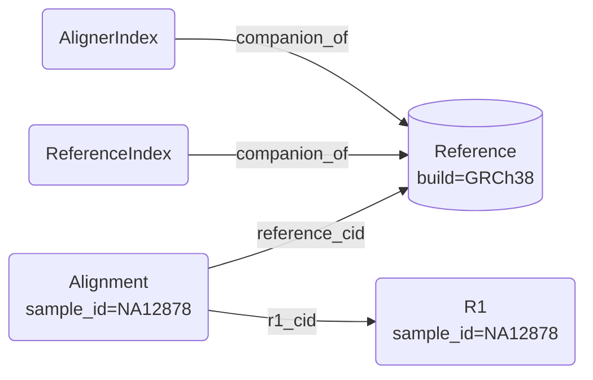

# Stargazer

Stargazer is built on two ideas. **A notebook is production code**, so the analysis you explore on one sample is the analysis that runs on a hundred across a cluster. **Data knows what it is**, so that work finds its inputs by asking, not by path.

## Production-grade notebooks

The tasks a notebook calls are the same typed, versioned, containerized code that runs in production. Each task declares its image and its resources (CPU, memory, GPUs), so **where a run goes is a switch in the notebook, never a change to the code**:

```python
where = run_location()  # "On this machine" | "On the cluster"

results = await asyncio.gather(
    *(dispatch(where, qc_filter, adata=a) for a in samples)
)
```

On this machine, that cell runs in the notebook's own process on whatever you're exploring. On the cluster, the same cell fans each sample out to its own pod, with the image and the hardware its task asked for, and returns typed assets to the notebook either way.

- **One notebook spans the whole range**, from a scratchpad on a slice of data to the production interface for a full cohort. Nothing is rewritten or handed off in between.
- **Run mode makes it an app.** The same notebook served read-only is a pipeline front end, driven by the controls you built while exploring.
- **Tasks promote into the SDK.** A task written in a notebook can move into Stargazer, ship in the next image, and be imported by every notebook and workflow ([Notebooks → Promotion](architecture/notebook.md#promotion)).
- **Notebooks travel as code.** A notebook in any GitHub repo opens into your workspace. Since it asks the [asset graph](#the-asset-graph) for its data, it runs against yours unchanged.

The Execution tutorial introduces the switch, and [Notebooks](architecture/notebook.md) covers how they're served and run.

## The asset graph

Every file is an asset: an ID computed from its bytes, a type with typed fields such as `sample_id` or `build`, and links to the assets it relates to. Those assets and links are the **asset graph**. Tasks write into it, workflows query it, and publishing extends it to everyone.



A `companion_of` link means "belongs beside", the way an index belongs beside its FASTA, and `fetch()` brings companions along into the same directory. An `<asset>_cid` link means "made from", and `assemble(reference_cid=ref.cid)` finds everything made from that reference.

- **Workflows take questions, not files.** The germline pipeline is called with a build and sample IDs. It finds the reference, its indices and each sample's reads in the graph, whether you uploaded them, a bundle brought them in or a colleague published them.

    ```python
    vcf = await germline_short_variant_discovery(
        build="GRCh38", sample_ids=["NA12878", "NA12891"]
    )
    ```

- **Every run grows the graph.** A task stores its output with its type, its fields and a link to what it was made from. Nobody files it, and the next query sees it.
- **The graph grows with your work.** Tag any asset with a key its type doesn't declare and query on it. A type defined in a notebook cell is in the graph as soon as the cell runs, and records written before a field existed still load.
- **Identity outlives location.** The same file has the same ID on your laptop, in a cloud bucket and on the public network, so a notebook that names an asset by ID reads the same bytes for anyone who opens it.
- **Collaboration without coordination.** Publish an asset and it joins everyone's queries, under your name. A colleague's workflow finds it by the same metadata it uses for their own data, and their outputs link back to it.

[Types and Asset System](architecture/types.md) holds the full contract, and the Assets tutorial walks through it live.

## Interface

The [hosted app](getting-started.md#hosted) gives you a workspace of marimo notebooks for learning, running pipelines and authoring, with a cluster behind it. Each release publishes one image, **`stargazer`**, which runs the same notebooks locally with Claude Code or OpenCode in the agent panel. The SDK is a first-class surface too: import its tasks and author workflows in an IDE. The MCP server gives any MCP client (Claude Code, OpenCode, Cursor) the same tasks, workflows and asset graph.

## Documentation

- [Getting Started](getting-started.md): from zero to your first workflow
- [Architecture](architecture/overview.md): how the system is designed and why
- [Guides](guides/writing-a-task.md): step-by-step walkthroughs for common work
- [Contributing](guides/contributing.md): set up a dev environment and run tests
- [API Reference](reference/api.md): generated from docstrings
